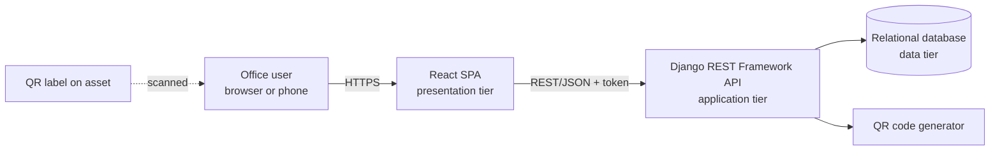

<!-- center -->

**DESIGN AND IMPLEMENTATION OF A WEB-BASED ASSET MANAGEMENT SYSTEM FOR A CORPORATE OFFICE**

PROJECT PROPOSAL

BY

OLUWAMUREWA, Abiodun (E052852) — Team Leader

ABEGUNDE, Jimmy (E051739)

MOSOBALAJE, Opeyemi (E051727)

SUBMITTED TO

THE DEPARTMENT OF COMPUTER SCIENCE,

FACULTY OF SCIENCE,

UNIVERSITY OF IBADAN, IBADAN, NIGERIA

IN PARTIAL FULFILLMENT OF THE REQUIREMENTS FOR THE AWARD OF THE DEGREE OF BACHELOR OF SCIENCE (B.Sc.) IN COMPUTER SCIENCE

SUPERVISOR: Prof. B. F. Oladejo

[DATE]

<!-- /center -->

# 1. BACKGROUND OF THE STUDY

Every corporate office depends on physical assets to function. Examples include laptops and desktop computers, printers, projectors, network equipment, air-conditioners, office furniture and pool vehicles. Together these items are a large share of an organisation's capital. They must be recorded, kept in working order, assigned to responsible staff, depreciated in the books of account and eventually disposed of. The international standard for asset management, ISO 55000, describes this discipline as the coordinated activity of an organisation to realise value from its assets. It is built on the principles of value, alignment, leadership and assurance (ISO, 2024; ISO/TC 251, 2024).

In many organisations, and especially in small and medium-sized offices in Nigeria, asset records are still kept in paper registers or spreadsheets. Kusumojati and Mediawati (2024) reviewed a decade of studies and found that organisations without a dedicated system rely on tools such as Microsoft Excel, which makes asset data difficult to trace and prone to error. Studies of the Nigerian public sector likewise report that asset management practice "is yet to be at its peak" (Makama, 2022). They also report that the physical asset base of institutions is managed without clear strategy (Hamma, 2008). Meanwhile, low-cost identification technologies have matured. Quick Response (QR) codes can be printed on ordinary label paper and read by any smartphone camera (DENSO WAVE, n.d.). This makes item-level asset tracking affordable for even a modest office (Benrahman, 2021; Rizqi et al., 2018).

This project proposes a web-based asset management system for a corporate office. It will give the office one central register of all assets, a QR code label on each item, records of who holds each asset, maintenance scheduling, automatic depreciation in line with IAS 16 *Property, Plant and Equipment* (IFRS Foundation, n.d.), and a complete audit trail.

The case study is **Squad by HabariPay**, where the Team Leader is an intern. Squad is a payment platform for businesses in Africa, operated by HabariPay Limited, a subsidiary of Guaranty Trust Holding Company Plc (GTCO) licensed by the Central Bank of Nigeria (Guaranty Trust Holding Company Plc, n.d.; HabariPay Limited, n.d.). GTCO unveiled Squad as its payments unit in June 2022, and the business crossed ₦200 billion in monthly transactions within its first year (Eleanya, 2022; Akintaro, 2023). A fast-growing fintech office of this kind, with staff spread across teams and many portable IT assets such as laptops, monitors and test devices, is a good setting in which to design and evaluate the system. The project is an academic exercise: it does not claim that the company has endorsed or adopted the system, and the demonstration system will use illustrative seed data modelled on a fintech office rather than the company's real data.

# 2. STATEMENT OF THE PROBLEM

Typical corporate offices that track assets manually face the following problems:

1. **No single source of truth.** Asset details are spread across spreadsheets, purchase files and individual memory. It is hard to answer basic questions such as "how many laptops do we own, where are they and who has them?"
2. **Poor accountability.** Items are handed to staff without a recorded check-out. When equipment is lost or damaged, nobody can tell who last held it.
3. **Neglected maintenance.** Preventive servicing of items such as generators, air-conditioners and printers is not scheduled. Overdue servicing goes unnoticed until the equipment breaks down.
4. **Inaccurate asset values.** Depreciation is calculated by hand at year end, if at all, so the book value of assets in the financial statements is often unreliable.
5. **Slow audits and verification.** Physical verification means matching items against long printed lists. There is no quick way to identify an item on the spot.
6. **No audit trail.** Changes to asset records are not logged, which weakens internal control. Disposals are poorly documented (Atiga et al., 2015).

# 3. AIM AND OBJECTIVES

**Aim:** To design and implement a web-based asset management system that enables a corporate office to register, track, maintain, value and dispose of its physical assets from one secure, central platform.

**Objectives:** The specific objectives are to:

1. Design and implement a central asset register that gives each asset a unique auto-generated tag (e.g. AST-0001). The register must support search and filtering by category, location, department, status and custodian.
2. Generate a printable QR code label for every asset that, when scanned with a smartphone, opens that asset's record within five seconds.
3. Implement check-out/check-in of assets to staff members with full assignment history, and maintenance scheduling with automatic detection of overdue jobs.
4. Implement automatic computation of current book value and full depreciation schedules using the straight-line and declining-balance methods recognised by IAS 16.
5. Enforce role-based access control (administrator, manager, staff) and record every change in an audit trail, with a summary dashboard and downloadable CSV reports.
6. Evaluate the system through functional test cases and a System Usability Scale (SUS) survey of at least 20 staff of the case-study organisation, targeting a mean SUS score of at least 68 (Brooke, 1996; Sauro, 2011).

# 4. JUSTIFICATION

- **Accountability and loss reduction.** Every hand-over is recorded against a named staff member, with dates and return condition. This discourages loss and makes responsibility clear.
- **Lower cost of tracking.** QR labels cost almost nothing and need no special reader, unlike Radio Frequency Identification (RFID). This makes item-level tracking affordable for a typical office (Benrahman, 2021).
- **Financial accuracy.** Automatic depreciation consistent with IAS 16 gives management and auditors reliable book values at any date (IFRS Foundation, n.d.).
- **Asset life extension.** Scheduled preventive maintenance with overdue alerts reduces breakdowns and extends useful life.
- **Better decisions.** A live dashboard of asset counts, values, status and upcoming maintenance supports budgeting and replacement planning.
- **Academic value.** The project brings together web engineering, database design, REST architecture (Fielding, 2000), accounting logic and usability evaluation in one realistic information system.

# 5. SCOPE AND LIMITATIONS

**Scope.** The system will cover the full lifecycle of the physical assets of a single corporate office, using Squad by HabariPay as the case study:

- registration of assets with categories, locations, departments and a photograph of each asset;
- QR code labels and a scan page;
- check-out/check-in;
- preventive and corrective maintenance;
- depreciation by straight-line and declining-balance;
- disposal (sold, donated, scrapped or lost);
- an audit log, a dashboard and CSV reports;
- three user roles: admin, manager and staff;
- an in-app usability survey page.

All amounts are in Nigerian Naira (NGN).

**Limitations.**

- The system tracks tangible assets only. Software licences and consumable stock are not covered.
- It does not use RFID or GPS for automatic real-time location. Location is updated when staff record a movement.
- It is not integrated with an external accounting/ERP package. Values are exported as CSV instead.
- It is a responsive web application rather than a native mobile app.
- The usability evaluation is limited to a small sample of about 20 staff of the case-study organisation.

# 6. PROPOSED METHODOLOGY

## 6.1 Development approach

The project will follow an Agile, incremental approach. The system will be delivered in short iterations, each producing working software that is reviewed with the supervisor and prospective users. This suits the project because it values "working software over comprehensive documentation" and "responding to change over following a plan" (Beck et al., 2001). Agile methods are characterised as incremental, cooperative, straightforward and adaptive (Abrahamsson et al., 2002). The planned increments are:

1. authentication, roles and reference data;
2. the asset register and QR labels;
3. check-out/check-in and audit trail;
4. maintenance and disposal;
5. depreciation, dashboard and reports;
6. testing and usability evaluation.

## 6.2 Requirements gathering

Requirements will be gathered by:

- direct observation of how equipment is issued, used and returned at the case-study organisation, by the Team Leader during an internship there *[Team: add the names/roles of any staff consulted and what they said]*;
- review of existing systems such as the open-source Snipe-IT (Grokability, n.d.) and of spreadsheet-based registers;
- review of the literature on web-based, QR and RFID asset tracking.

## 6.3 Tools and technologies

**Table 1: Proposed tools and technologies**

| Layer | Tool / technology | Purpose |
|---|---|---|
| Back end | Python, Django 6.1, Django REST Framework | Business logic, data models and RESTful API with token authentication |
| Database | SQLite (development); PostgreSQL (deployment option) | Relational storage of assets, users, assignments, maintenance and audit records |
| Front end | React 19, TypeScript, Vite, Tailwind CSS, shadcn/ui conventions, Bklit UI charts (built on visx) | Responsive single-page web interface with dashboard charts |
| QR codes | Python `qrcode` library with Pillow | Generation of PNG QR labels encoding each asset's scan URL |
| Design | Unified Modelling Language (UML), Mermaid | Use case, class, sequence and activity diagrams; ERD |
| Version control | Git and GitHub | Source control and team collaboration |
| Evaluation | System Usability Scale questionnaire, delivered on an in-app survey page | Measurement of perceived usability, with results computed by the system |

Table 1 summarises the technology stack. Django and Django REST Framework were chosen for their built-in object-relational mapper, authentication and admin facilities (Django Software Foundation, n.d.; Django REST framework, n.d.). React was chosen for its component-based user interfaces (Meta Platforms, n.d.).

## 6.4 Proposed architecture

The system will use a three-tier client–server architecture. The React single-page application in the browser communicates over HTTPS with a stateless REST API built in Django REST Framework. The API reads and writes a relational database. QR labels encode a URL of the form `/scan/AST-0001`. Scanning a label with any phone opens the asset's page in the browser. Figure 1 sketches the architecture.

*Figure 1: Proposed three-tier architecture of the asset management system*

## 6.5 Evaluation

The system will be verified with functional test cases, each comparing the expected result with the actual result. Usability will be measured with the 10-item System Usability Scale (Brooke, 1996), given to about 20 staff of Squad by HabariPay after they complete set tasks. Responses will be collected on a survey page built into the system, which needs no login and records the SUS items, demographics, task completion and comments; an endpoint will compute the number of responses, the mean, median and standard deviation of the scores, the per-item distributions and the task completion rates. Scores will be interpreted against published benchmarks (Bangor et al., 2008; Sauro, 2011).

# 7. EXPECTED DELIVERABLES

1. A working web-based asset management system: a Django REST API and a React front end, with source code on GitHub (https://github.com/Psybah/asset-management).
2. A full project report (write-up) following the departmental template.
3. Design documents: requirements, architecture, use case, ERD, class, sequence and activity diagrams.
4. A test report and a usability evaluation report (SUS results).
5. A folder of all literature cited.
6. A user guide with demonstration accounts.

# 8. WORK PLAN

**Table 2: Project work plan (weeks are indicative)**

| Phase | Activities | Weeks | Responsible |
|---|---|---|---|
| 1. Proposal and literature review | Topic definition, literature search and synthesis, proposal writing | 1–2 | ABEGUNDE (literature); all members |
| 2. Requirements and design | Observation at the case-study organisation, requirements specification, UML diagrams, database design | 3–4 | OLUWAMUREWA |
| 3. Increment 1–2 | Authentication, roles, reference data, asset register, QR labels | 5–6 | OLUWAMUREWA |
| 4. Increment 3–4 | Check-out/check-in, audit trail, maintenance, disposal | 7–8 | OLUWAMUREWA |
| 5. Increment 5 | Depreciation module, dashboard, CSV reports, survey page | 9 | OLUWAMUREWA |
| 6. Testing and evaluation | Functional testing, SUS usability survey, bug fixing | 10–11 | OLUWAMUREWA, all members |
| 7. Documentation and presentation | Final write-up, slides, defence | 12 | [SURNAME] (write-up), all members |

Table 2 shows the planned phases. Phases 3 to 5 are Agile increments. Each ends with a review, and the feedback from each review shapes the next increment.

# REFERENCES

Abrahamsson, P., Salo, O., Ronkainen, J., and Warsta, J. (2002). *Agile software development methods: Review and analysis* (VTT Publications 478). Espoo: VTT Technical Research Centre of Finland. Retrieved from https://arxiv.org/abs/1709.08439

Akintaro, S. (2023, May 2). GTCO's fintech business, Squad, crossed N200 billion transactions in January 2023. *Nairametrics*. Retrieved November 19, 2026, from https://nairametrics.com/2023/05/02/gtcos-fintech-business-squad-crossed-n200-billion-transactions-in-january-2023/

Atiga, O., Adafula, C. J., and Nyeadi, J. D. (2015). Statutory compliance in assets disposal practices in the public sector: Evidence from Ghana. *Journal of Transport and Supply Chain Management, 9*(1), Article 158. https://doi.org/10.4102/jtscm.v9i1.158

Bangor, A., Kortum, P. T., and Miller, J. T. (2008). An empirical evaluation of the System Usability Scale. *International Journal of Human–Computer Interaction, 24*(6), 574–594. https://doi.org/10.1080/10447310802205776

Beck, K., Beedle, M., van Bennekum, A., Cockburn, A., Cunningham, W., Fowler, M., Grenning, J., Highsmith, J., Hunt, A., Jeffries, R., Kern, J., Marick, B., Martin, R. C., Mellor, S., Schwaber, K., Sutherland, J., and Thomas, D. (2001). Manifesto for agile software development. Retrieved November 19, 2026, from https://agilemanifesto.org/

Benrahman. (2021). Asset management information and tracking system with QR code based on the human centred design method. *Journal of Physics: Conference Series, 1830*(1), 012006. https://doi.org/10.1088/1742-6596/1830/1/012006

Brooke, J. (1996). SUS: A "quick and dirty" usability scale. In P. W. Jordan, B. Thomas, B. A. Weerdmeester, and I. L. McClelland (Eds.), *Usability evaluation in industry* (pp. 189–194). London: Taylor and Francis. https://doi.org/10.1201/9781498710411-35

DENSO WAVE. (n.d.). History of QR Code. Retrieved November 19, 2026, from https://www.qrcode.com/en/history/

Django REST framework. (n.d.). Django REST framework [Documentation]. Retrieved November 19, 2026, from https://www.django-rest-framework.org/

Django Software Foundation. (n.d.). Django documentation (Version 6.1). Retrieved November 19, 2026, from https://docs.djangoproject.com/en/6.1/

Eleanya, F. (2022, June 1). GTCO names Squad as new fintech unit. *BusinessDay*. Retrieved November 19, 2026, from https://businessday.ng/technology/article/gtco-names-squadco-as-new-fintech-unit/

Fielding, R. T. (2000). *Architectural styles and the design of network-based software architectures* (Doctoral dissertation, University of California, Irvine). Retrieved from https://ics.uci.edu/~fielding/pubs/dissertation/top.htm

Grokability, Inc. (n.d.). Snipe-IT: Free open source IT asset management. Retrieved November 19, 2026, from https://snipeitapp.com/

Guaranty Trust Holding Company Plc. (n.d.). Squad by HabariPay. Retrieved November 19, 2026, from https://www.gtcoplc.com/what-we-do/digital-payments

HabariPay Limited. (n.d.). Squad – About. Retrieved November 19, 2026, from https://squadco.com/about/

Hamma, H. (2008). *Improving the management of assets in the Nigerian federal colleges of education* (Doctoral thesis, University of Leeds). Retrieved from https://etheses.whiterose.ac.uk/217/

IFRS Foundation. (n.d.). IAS 16 Property, Plant and Equipment. Retrieved November 19, 2026, from https://www.ifrs.org/issued-standards/list-of-standards/ias-16-property-plant-and-equipment/

International Organization for Standardization. (2024). *ISO 55000:2024 Asset management — Vocabulary, overview and principles* (2nd ed.). Geneva: ISO. Retrieved November 19, 2026, from https://www.iso.org/standard/83053.html

ISO/TC 251. (2024). *ISO 55000:2024 updated overview of asset management*. Geneva: International Organization for Standardization. Retrieved November 19, 2026, from https://committee.iso.org/files/live/sites/tc251/files/guidance/ISO%20TC251%20ISO55000%20Rev3.pdf

Kusumojati, P. P., and Mediawati, E. (2024). Web-based asset management information systems in higher education. *International Journal of Business, Law, and Education, 5*(1), 398–411. https://doi.org/10.56442/ijble.v5i1.382

Makama, C. A. (2022). *Investigating the role of knowledge management in the development of asset management practice in selected public sector organisations in Nigeria* (Doctoral thesis, University of Wales Trinity Saint David). Retrieved from https://repository.uwtsd.ac.uk/id/eprint/2087/

Meta Platforms, Inc. (n.d.). React: The library for web and native user interfaces. Retrieved November 19, 2026, from https://react.dev/

Rizqi, R. I., Rohma, N. A., and Nimkerdphol, K. (2018). Inventory management system using QR code on Android: A case study in Computer Engineering Department. *JEECS (Journal of Electrical Engineering and Computer Sciences), 3*(1), 381–388. https://doi.org/10.54732/jeecs.v3i1.144

Sauro, J. (2011, February 3). Measuring usability with the System Usability Scale (SUS). Retrieved November 19, 2026, from the MeasuringU website: https://measuringu.com/sus/
