<!-- center -->

**DESIGN AND IMPLEMENTATION OF A WEB-BASED ASSET MANAGEMENT SYSTEM FOR A CORPORATE OFFICE**

BY

ABIODUN, Oluwamurewa

E052852

ABEGUNDE, Jimmy

[MATRIC NUMBER]

[SURNAME, Other names]

[MATRIC NUMBER]

[SURNAME, Other names]

[MATRIC NUMBER]

SUBMITTED

TO

THE DEPARTMENT OF COMPUTER SCIENCE,

FACULTY OF SCIENCE,

UNIVERSITY OF IBADAN, IBADAN, NIGERIA

IN PARTIAL FULFILLMENT OF THE REQUIREMENTS FOR THE AWARD OF THE DEGREE OF BACHELOR OF SCIENCE (B.Sc.) IN COMPUTER SCIENCE.

[MONTH, YEAR]

<!-- /center -->

# CERTIFICATION

This is to certify that this project, **Design and Implementation of a Web-Based Asset Management System for a Corporate Office**, was carried out by us:

| Name | Matriculation Number |
|---|---|
| ABIODUN, Oluwamurewa (Team Leader) | E052852 |
| ABEGUNDE, Jimmy | [MATRIC NUMBER] |
| [SURNAME, Other names] | [MATRIC NUMBER] |
| [SURNAME, Other names] | [MATRIC NUMBER] |

in the Department of Computer Science, University of Ibadan, and was duly supervised by [SUPERVISOR NAME].

&nbsp;

&nbsp;

…………………………………………                …………………………
[SUPERVISOR NAME (Title Lastname Initials)]                Date
(Supervisor)

&nbsp;

&nbsp;

…………………………………………                …………………………
[HOD NAME (Title Lastname Initials)]                Date
(Head of Department)

# DEDICATION

This project work is dedicated to the Almighty God, the giver of life and wisdom, and to our parents and guardians for their love, sacrifice and constant support throughout our study.

[TEAM MAY EDIT THIS DEDICATION]

# ACKNOWLEDGEMENT

We acknowledge the sustaining power of the Almighty God, who gave us the wisdom, strength and understanding to complete this work.

We sincerely appreciate our supervisor, [SUPERVISOR NAME], for the guidance, patience and constructive criticism that shaped this project from proposal to completion.

We thank the Head of Department, [HOD NAME], and all the academic and non-academic staff of the Department of Computer Science, University of Ibadan, for the knowledge and support they gave us throughout our stay in the department.

We are grateful to the staff of [CASE-STUDY OFFICE / ORGANISATION NAME] who shared their asset records and workflows with us and who took part in the usability evaluation.

Finally, we thank our families, friends and classmates for their encouragement, and each member of the team for the commitment and cooperation that made this group project a success.

# TEAM MEMBERS' PARTICIPATION

*To be completed and signed by the Team Leader only. The roles and percentages below are suggestions and are **to be confirmed by the Team Leader**.*

**Table i: Team members' participation**

| S/N | Name | Matric No. | Role | Contribution | % |
|---|---|---|---|---|---|
| 1 | ABIODUN, Oluwamurewa | E052852 | Team Lead; Backend Development and Project Management | Coordinated the team and work plan; designed the database and REST API; implemented the asset register, check-out/check-in, maintenance, depreciation and audit modules; integrated front end and back end | [__] (to be confirmed by Team Leader) |
| 2 | ABEGUNDE, Jimmy | [MATRIC NUMBER] | Frontend / User Interface Development | Designed the user interface; implemented the React pages (dashboard, asset register, asset detail, QR scan page, maintenance and reports) | [__] (to be confirmed by Team Leader) |
| 3 | [SURNAME, Other names] | [MATRIC NUMBER] | Documentation and Literature Review | Literature search and review (Chapter Two), requirements gathering, UML diagrams, compilation of the proposal and final report | [__] (to be confirmed by Team Leader) |
| 4 | [SURNAME, Other names] | [MATRIC NUMBER] | Testing and Evaluation | Wrote and ran functional test cases, administered the SUS questionnaire, analysed the usability results (Chapter Four) | [__] (to be confirmed by Team Leader) |
| | **Total** | | | | **100%** |

&nbsp;

…………………………………………                …………………………
ABIODUN, Oluwamurewa (Team Leader)                Date

# ABSTRACT

Corporate offices hold a large share of their capital in physical assets such as computers, printers, furniture, network equipment and vehicles. Yet many offices, particularly in Nigeria, still record these assets in paper registers and spreadsheets. As a result, nobody can say reliably where an asset is or who holds it. Maintenance is missed, depreciation and book values are calculated by hand and are often wrong, and changes to records leave no audit trail. This project set out to replace such manual practice with one secure, central platform for managing the full asset lifecycle.

The system was developed with an Agile, incremental approach. Requirements were gathered by reviewing existing registers, the literature and existing tools such as Snipe-IT. The design was modelled in UML (use case, class, sequence and activity diagrams) and an entity–relationship model. The system has a three-tier architecture: a React single-page front end, a RESTful application programming interface built with Django REST Framework and token authentication, and a relational database. Each asset receives an auto-generated tag and a QR code label that opens the asset's record when scanned with a smartphone. Depreciation is computed with the straight-line and declining-balance methods recognised by IAS 16, and access is controlled by three roles: administrator, manager and staff.

The resulting system provides:

- an asset register with search and filters, and QR labels with a scan page;
- check-out/check-in with full custody history;
- preventive and corrective maintenance scheduling with overdue detection;
- automatic depreciation schedules and current book values;
- a disposal workflow, an audit trail, a dashboard and CSV reports.

The system was verified against 26 functional test cases, of which 25 passed when executed and the remaining one (scanning a printed label with a physical phone) is pending *[Team: update after TC9]*. A System Usability Scale survey of [NUMBER] office users gave a mean score of [SUS SCORE], which is [ABOVE/BELOW] the commonly cited benchmark of 68. *[Placeholders: replace with the real test and survey results before submission.]* The system shows that a low-cost, web-based, QR-enabled solution can significantly improve accountability, maintenance and financial accuracy in managing office assets.

**Keywords:** asset management, QR code, web application, depreciation, Django REST Framework, React, System Usability Scale

# TABLE OF CONTENTS

| Content | Page |
|---|---|
| Title page | i |
| Certification | ii |
| Dedication | iii |
| Acknowledgement | iv |
| Team Members' Participation | v |
| Abstract | vi |
| Table of Contents | vii |
| List of Figures | ix |
| List of Tables | x |
| **CHAPTER ONE: INTRODUCTION** | 1 |
| 1.1 Preamble | 1 |
| 1.2 Statement of the Problem | 2 |
| 1.3 Aim and Objectives | 3 |
| 1.4 Justification | 3 |
| 1.5 Scope of the Study | 4 |
| 1.6 Methodology | 5 |
| 1.7 Organisation of the Report | 5 |
| **CHAPTER TWO: REVIEW OF RELEVANT LITERATURE** | [ ] |
| 2.1 Concept of Assets and Asset Management | [ ] |
| 2.2 IT Asset Management | [ ] |
| 2.3 Asset Identification and Tracking Technologies | [ ] |
| 2.4 Depreciation Accounting and IAS 16 | [ ] |
| 2.5 Review of Existing Systems | [ ] |
| 2.6 Related Academic Works | [ ] |
| 2.7 Usability Evaluation and the System Usability Scale | [ ] |
| 2.8 Research Gap | [ ] |
| **CHAPTER THREE: METHODOLOGY** | [ ] |
| 3.1 Development Methodology | [ ] |
| 3.2 Requirements Analysis | [ ] |
| 3.3 System Architecture | [ ] |
| 3.4 System Modelling (UML) | [ ] |
| 3.5 Database Design | [ ] |
| 3.6 API Design | [ ] |
| 3.7 Evaluation Design | [ ] |
| **CHAPTER FOUR: SYSTEM IMPLEMENTATION, TESTING AND RESULTS** | [ ] |
| 4.1 Implementation Environment and Tools | [ ] |
| 4.2 Module Implementation | [ ] |
| 4.3 Key Algorithms | [ ] |
| 4.4 User Interface | [ ] |
| 4.5 System Testing | [ ] |
| 4.6 Usability Evaluation | [ ] |
| 4.7 Discussion of Results | [ ] |
| **CHAPTER FIVE: SUMMARY, CONCLUSION AND RECOMMENDATIONS** | [ ] |
| 5.1 Summary | [ ] |
| 5.2 Conclusion | [ ] |
| 5.3 Recommendations and Future Work | [ ] |
| References | [ ] |
| Appendix | [ ] |

*(Page numbers to be completed after final formatting in Word. Use References → Table of Contents in Word to generate them automatically.)*

# LIST OF FIGURES

| Figure | Page |
|---|---|
| 2.1 The asset lifecycle in a corporate office | [ ] |
| 3.1 Agile incremental development model adopted for the project | [ ] |
| 3.2 Three-tier architecture of the asset management system | [ ] |
| 3.3 Use case diagram of the asset management system | [ ] |
| 3.4 Entity–relationship diagram (ERD) | [ ] |
| 3.5 Class diagram of the core domain | [ ] |
| 3.6 Sequence diagram for asset check-out | [ ] |
| 3.7 Activity diagram for maintenance scheduling and completion | [ ] |
| 3.8 State diagram of asset status | [ ] |
| 4.1 Login page | [ ] |
| 4.2 Dashboard | [ ] |
| 4.3 Asset register with search and filters | [ ] |
| 4.4 Asset detail page with QR code, timeline and depreciation | [ ] |
| 4.5 Printable QR label and mobile scan page | [ ] |
| 4.6 Check-out and check-in dialogs | [ ] |
| 4.7 Maintenance schedule showing an overdue job | [ ] |
| 4.8 Audit log | [ ] |
| 4.9 Reports page and exported CSV | [ ] |
| 4.10 Distribution of individual SUS scores | [ ] |

# LIST OF TABLES

| Table | Page |
|---|---|
| i Team members' participation | v |
| 2.1 Comparison of asset identification technologies | [ ] |
| 2.2 Worked example of straight-line and declining-balance depreciation | [ ] |
| 2.3 Comparison of existing asset management approaches | [ ] |
| 2.4 Summary of related academic works | [ ] |
| 3.1 Functional requirements | [ ] |
| 3.2 Non-functional requirements | [ ] |
| 3.3 User roles and permissions | [ ] |
| 3.4 Structure of the User table | [ ] |
| 3.5 Structure of the Asset table | [ ] |
| 3.6 Structure of the Assignment table | [ ] |
| 3.7 Structure of the Maintenance table | [ ] |
| 3.8 Structure of the Disposal table | [ ] |
| 3.9 Structure of the AuditLog table | [ ] |
| 3.10 Structure of the reference tables (Category, Location, Department) | [ ] |
| 3.11 Summary of REST API endpoints | [ ] |
| 4.1 Implementation tools and justification | [ ] |
| 4.2 Depreciation schedule produced by the system for a sample asset | [ ] |
| 4.3 Functional test cases and results | [ ] |
| 4.4 System Usability Scale items and scoring rule | [ ] |
| 4.5 Demographic profile of respondents | [ ] |
| 4.6 Responses to "I thought the system was easy to use" (SUS item 3) | [ ] |
| 4.7 Responses to "I think that I would like to use this system frequently" (SUS item 1) | [ ] |
| 4.8 Responses to "I think that I would need the support of a technical person to be able to use this system" (SUS item 4) | [ ] |
| 4.9 Mean response per SUS item | [ ] |
| 4.10 Summary of SUS scores | [ ] |
| 4.11 Task completion rates | [ ] |
| 4.12 Achievement of project objectives | [ ] |


# CHAPTER ONE

## 1.0 INTRODUCTION

### 1.1 PREAMBLE

An asset is any item, thing or entity that has potential or actual value to an organisation. Asset management is the coordinated activity of an organisation to realise value from its assets. These are the definitions behind the ISO 55000 family of international standards (ISO, 2024). In a corporate office the most visible assets are physical:

- desktop and laptop computers, printers, scanners and projectors;
- network and telephony equipment;
- air-conditioners and generators;
- office furniture and pool vehicles.

These items are bought with significant capital. Staff depend on them every day, and their value declines over time through use, wear and obsolescence.

Managing these assets well involves much more than buying them. Each asset must be:

- registered and uniquely identified;
- assigned to a responsible custodian and a location;
- maintained so that it continues to perform;
- valued correctly in the financial statements through depreciation;
- disposed of transparently at the end of its useful life.

The 2024 revision of ISO 55000 stresses that asset management should be built on value, alignment, leadership and assurance. It also stresses that organisations should be able to show that their assets deliver the outcomes expected of them (ISO/TC 251, 2024).

In practice, many organisations fall short of this ideal. Kusumojati and Mediawati (2024) reviewed studies published between 2013 and 2023. They found that many institutions have no internal system for controlling assets and rely on generic tools such as Microsoft Excel, which makes asset data hard to trace and prone to error. In Nigeria, Makama (2022) interviewed asset managers and fixed-asset officers across the six geo-political zones and concluded that asset management practice in federal public-sector organisations "is yet to be at its peak". Hamma (2008) earlier showed that the physical asset base of Nigerian federal colleges of education was managed without a coherent asset strategy. Small and medium-sized enterprises face similar problems. Agboola et al. (2022) observe that most businesses still keep records manually or in spreadsheets, which is slow, error-prone and costly.

Web technologies and low-cost identification technologies now make a better approach affordable. A web application can be reached from any browser on the office network or the internet, with no installation on each computer. Quick Response (QR) codes were invented by DENSO WAVE in 1994 and later standardised by ISO (DENSO WAVE, n.d.; ISO/IEC, 2024). They can be printed cheaply on labels and read by the camera of any modern smartphone. Several studies have shown that attaching a QR code that links to a web record makes it much faster to identify an asset and look up its history (Benrahman, 2021; Rizqi et al., 2018; Sulistyo et al., 2022).

This project applies these ideas to the corporate office. It designs and implements a web-based asset management system that keeps a central register of assets, labels each asset with a QR code, records check-out and check-in to staff, schedules maintenance, computes depreciation according to IAS 16 *Property, Plant and Equipment* (IFRS Foundation, n.d.), and keeps a complete audit trail of every change.

### 1.2 STATEMENT OF THE PROBLEM

Our review of typical office practice and of the literature found the following problems in offices that manage assets manually or with spreadsheets:

1. **Fragmented and unreliable records.** Asset data is spread across purchase files, spreadsheets kept by different units, and staff memory. There is no single, current register, so simple questions such as "how many laptops do we have and where are they?" cannot be answered quickly or accurately (Kusumojati and Mediawati, 2024).
2. **Weak custody and accountability.** Equipment is often handed to staff informally. When an item is missing or damaged, there is no record of who last held it, when it was issued or what condition it was returned in (Wijaya and Imanuel, 2021).
3. **Reactive maintenance.** Preventive maintenance of items such as generators, air-conditioners and printers is not scheduled or tracked. Overdue servicing is noticed only after a breakdown, which shortens the asset's life and raises repair costs.
4. **Inaccurate asset valuation.** Depreciation is computed by hand, inconsistently or only at year end. The book values reported to management and auditors are therefore unreliable, and the depreciation method and useful life are rarely reviewed as IAS 16 requires.
5. **Slow physical verification.** Matching physical items against long printed lists during audits is laborious. There is no fast way to identify an item on the spot and see its record.
6. **No audit trail and poor disposal control.** Changes to records are not logged, and disposals are often undocumented or poorly controlled (Atiga et al., 2015). Both weaken internal control and make fraud easier.

This project addresses these problems with a central, web-based, role-secured asset register in which every asset has a scannable QR label. Every movement, maintenance event and disposal is recorded, and depreciation is calculated automatically.

### 1.3 AIM AND OBJECTIVES

**Aim:** To design and implement a web-based asset management system that enables a corporate office to register, track, maintain, value and dispose of its physical assets from a single, secure, central platform.

**Objectives:** The specific objectives of this project are to:

1. design and implement a central asset register that gives each asset a unique auto-generated tag (for example AST-0001) and supports search and filtering by category, location, department, status and custodian;
2. generate a printable QR code label for every asset that, when scanned with a smartphone camera, opens that asset's record within five seconds;
3. implement check-out/check-in of assets to named staff with a complete assignment history, and preventive/corrective maintenance scheduling with automatic detection of overdue jobs;
4. implement automatic computation of current book value and full depreciation schedules using the straight-line and declining-balance methods recognised by IAS 16;
5. enforce role-based access control (administrator, manager, staff), record every change in an audit trail, and provide a summary dashboard and downloadable CSV reports;
6. evaluate the system through functional test cases and a System Usability Scale (SUS) survey of at least 20 office users, with a target mean SUS score of at least 68.

### 1.4 JUSTIFICATION

The project is justified on the following grounds:

- **Accountability and loss prevention.** Recording every hand-over against a named member of staff, with dates and return condition, creates clear responsibility and discourages loss and misuse.
- **Affordability.** QR codes need only a printer and the cameras already on staff phones. Unlike RFID, they need no dedicated readers or tags (Benrahman, 2021). This puts item-level tracking within reach of offices with modest budgets.
- **Financial accuracy and compliance.** Automatic depreciation with the methods recognised in IAS 16 gives management and auditors consistent book values at any date (IFRS Foundation, n.d.).
- **Longer asset life and less downtime.** Scheduled preventive maintenance with overdue alerts moves the office from reactive repair to planned care.
- **Better decisions.** A live dashboard of asset counts, values, status, department holdings and upcoming maintenance supports budgeting, procurement and replacement planning.
- **Contribution to practice in Nigeria.** Studies show that asset management practice in Nigerian organisations is still weak (Makama, 2022; Gambo and Musonda, 2021). A practical, low-cost and open tool built on widely used open-source technologies adds to the solutions available locally.

### 1.5 SCOPE OF THE STUDY

The system manages the physical (tangible) assets of a single corporate office. Its scope includes:

- user authentication and three roles: administrator, manager and staff;
- reference data: asset categories (with default useful lives), locations and departments;
- an asset register with automatic tags, purchase details, location, department, status, condition and custodian;
- QR code generation for each asset and a scan page that resolves a tag to its record;
- check-out to and check-in from staff, with due dates, notes and return condition;
- preventive and corrective maintenance records with cost, vendor, status and overdue detection;
- depreciation by straight-line and (double) declining-balance, with schedules and current book value;
- disposal of assets by sale, donation, scrapping or loss;
- an audit log of all actions, a per-asset timeline, a dashboard and CSV export of the register.

The following are outside the scope of this project:

- intangible assets and software licences;
- consumable stock (stationery, toner);
- procurement and purchase-order workflows;
- automatic location tracking by RFID or GPS;
- integration with external accounting/ERP systems;
- native mobile applications.

All money values are in Nigerian Naira (NGN).

### 1.6 METHODOLOGY

The project followed an Agile, incremental development methodology (Beck et al., 2001; Abrahamsson et al., 2002). The steps were:

1. **Requirements gathering:** review of existing registers and spreadsheets, informal interviews with administrative and IT staff, review of existing tools (Snipe-IT and spreadsheets) and of the literature.
2. **System design:** a three-tier client–server architecture; UML use case, class, sequence and activity diagrams; an entity–relationship model; and a REST API contract.
3. **Incremental implementation:** a back end in Python with Django and Django REST Framework, and a front end in React with TypeScript. Development ran in five increments, each reviewed before the next began.
4. **Testing:** functional test cases comparing expected and actual results, including unit tests of the depreciation calculations.
5. **Evaluation:** a System Usability Scale (SUS) questionnaire (Brooke, 1996) given to office users after a set of tasks.

Chapter Three describes the methodology in detail.

### 1.7 ORGANISATION OF THE REPORT

The rest of this report is organised as follows:

- **Chapter Two** reviews the relevant literature: asset management concepts and ISO 55000, IT asset management, identification technologies, depreciation accounting, existing systems and related academic works. It ends by identifying the research gap.
- **Chapter Three** presents the methodology: requirements, architecture, UML models, database and API design.
- **Chapter Four** describes the implementation, testing and usability evaluation, and discusses the results.
- **Chapter Five** summarises the work, draws conclusions and makes recommendations for future work.


# CHAPTER TWO

## REVIEW OF RELEVANT LITERATURE

This chapter reviews the concepts, standards, technologies and previous works that inform the design of the proposed system. Sections 2.1 and 2.2 introduce asset management and IT asset management. Section 2.3 compares the technologies used to identify and track assets. Section 2.4 explains depreciation accounting under IAS 16. Section 2.5 reviews existing asset management tools, and Section 2.6 reviews related academic works. Section 2.7 introduces the System Usability Scale used to evaluate the system, and Section 2.8 identifies the gap this project fills.

### 2.1 CONCEPT OF ASSETS AND ASSET MANAGEMENT

#### 2.1.1 Assets

In accounting terms, the physical assets of an office are classified as **property, plant and equipment (PPE)**. These are tangible items held for use in producing goods or services, or for administrative purposes, and expected to be used for more than one period (IFRS Foundation, n.d.). The asset management standards define the term more broadly: an asset is any item, thing or entity that has potential or actual value to an organisation (ISO, 2024). In a corporate office the main asset classes are:

- information technology equipment: computers, laptops, printers, servers and network devices;
- office furniture and fittings;
- electrical and mechanical plant: air-conditioners and generators;
- motor vehicles.

#### 2.1.2 Asset management and ISO 55000

Asset management is the coordinated activity of an organisation to realise value from its assets (ISO, 2024). The ISO 55000 family provides the internationally accepted framework for it:

- **ISO 55000** sets out the vocabulary, overview and principles.
- **ISO 55001** gives the requirements for an asset management system.
- **ISO 55002** gives guidance on applying ISO 55001.

ISO 55000 was first published in 2014. It was revised in 2024, and the revision "provides essential vocabulary, principles, and an overarching framework for asset management" (ISO/TC 251, 2024). The 2024 edition reinforces the principles of value, alignment, leadership and outcome-focused asset management. It adds assurance, adaptability and sustainability as expected outcomes and introduces an asset management maturity framework (ISO/TC 251, 2024).

Three ideas from the standard shape this project:

1. **Lifecycle view.** Assets should be managed across their whole life, from acquisition through use and maintenance to disposal, not only at purchase.
2. **Information.** Good decisions require reliable, current information about each asset: what it is, where it is, its condition, its cost and its value.
3. **Assurance.** The organisation must be able to show that its assets are controlled. This calls for records and an audit trail.

Figure 2.1 shows the asset lifecycle as it applies to a corporate office. Each stage maps directly onto a module of the system described in Chapters Three and Four.

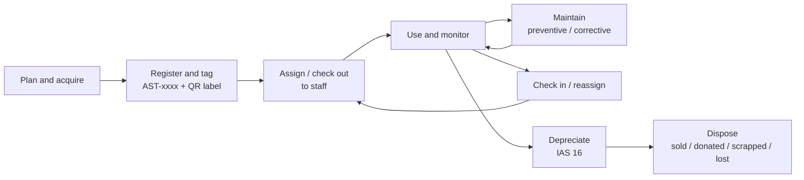

*Figure 2.1: The asset lifecycle in a corporate office*
*Source: Authors' design, based on the lifecycle and assurance principles of ISO 55000 (ISO/TC 251, 2024).*

The idea of using software tools to support asset management is not new. Vanier (2001) reviewed decision-support tools for municipal infrastructure assets and framed asset management around six questions an asset manager must be able to answer about the portfolio. He found that no single tool gave a complete solution, and that integration with existing maintenance, geographic and corporate systems was the greatest challenge. The same need for one integrated view of assets drives the present project, at the much smaller scale of an office.

#### 2.1.3 Asset management practice in Nigeria and Africa

Several studies document weak asset management practice in Nigeria and neighbouring countries:

- **Federal colleges of education.** Hamma (2008) studied the physical asset base of Nigerian Federal Colleges of Education, which faced tight budgets and rising demand. He developed an Asset Strategy Model to help each college align asset planning with its service priorities within available resources.
- **Federal public sector.** Makama (2022) interviewed 30 asset managers, fixed-asset officers and IT experts across Nigeria's six geo-political zones. He concluded that asset management practice in federal public-sector organisations "is yet to be at its peak", that knowledge management was not established, and that knowledge of asset management practice was lacking.
- **Road transport.** Gambo and Musonda (2021) surveyed project and facility managers in Nigerian road construction. They found that Fourth Industrial Revolution technologies such as IoT and cloud computing have a moderate positive effect on asset management practice, and identified poor asset management practice as a challenge in developing countries.
- **Disposal in Ghana.** Atiga et al. (2015) examined the disposal of unserviceable assets at five Ghanaian polytechnics. Few had internal disposal policies, disposal procedures were seen as hard to implement, and interference by top management in auctions was the biggest problem.

Together these studies show a clear need for simple, practical tools that make asset information visible and controlled across the whole lifecycle, including disposal.

### 2.2 IT ASSET MANAGEMENT

IT asset management (ITAM) is the part of asset management that deals with hardware and software used for information processing. In a modern office, IT equipment is usually the largest and fastest-depreciating group of assets. The IT Infrastructure Library (ITIL 4) treats IT asset management as a distinct management practice. Its purpose is to plan and manage the full lifecycle of all IT assets so that the organisation maximises value, controls costs and manages risk, from purchase through use to disposal (PeopleCert, n.d.).

The US National Institute of Standards and Technology (NIST) published practice guide SP 1800-5, *IT Asset Management* (Stone et al., 2018). It shows how an organisation can build an accurate, centralised inventory of its IT assets and use it to monitor and manage those assets more securely and efficiently. The guide stresses that an organisation cannot protect or manage assets it does not know it has, so a complete and current inventory comes first.

Al-Shatri et al. (2024) discuss digital transformation of the ITAM process. They argue that managing the lifecycle of growing numbers of hardware and software assets requires:

- a central repository for workstations, laptops and other assets;
- automated processes;
- identification technologies such as RFID.

The benefits they report include faster decisions, better use of assets, lower maintenance costs, and greater transparency and traceability.

These sources lead to three requirements for the present system: a single central repository, explicit lifecycle states for each asset, and a record of every change. The proposed system applies these ITAM principles to all office assets, not only IT equipment.

### 2.3 ASSET IDENTIFICATION AND TRACKING TECHNOLOGIES

Tracking an asset starts with identifying it reliably. Three main automatic identification technologies are used in asset management: linear barcodes, two-dimensional QR codes and Radio Frequency Identification (RFID).

#### 2.3.1 Barcodes

Linear (one-dimensional) barcodes encode a short identifier as parallel bars of varying width. A laser or camera scanner reads them in line of sight. They are cheap and mature. Elaskari et al. (2021) applied barcodes to periodic inventory of college assets (devices, equipment, furniture, rooms and laboratories) and to student attendance. They found that barcodes eliminated data-entry errors and improved efficiency, at a small cost for tags and scanning hardware. However, a linear barcode holds only a short identifier and usually needs a dedicated scanner.

#### 2.3.2 QR codes

The Quick Response (QR) code is a two-dimensional matrix barcode. It was developed by DENSO WAVE, then a division of DENSO Corporation, and announced in 1994 by a team led by Masahiro Hara. It became an ISO standard in 2000 (DENSO WAVE, n.d.). The current specification is ISO/IEC 18004:2024. It defines the encoding, symbol formats, error-correction rules and a reference decoding algorithm (ISO/IEC, 2024).

A QR code can hold far more data than a linear barcode, including a full web address (URL). Its built-in error correction lets it be read even when partly damaged, and the camera of any modern smartphone can decode it without special hardware. This makes QR codes particularly attractive for asset tagging. A label printed on ordinary paper can carry a link straight to the asset's online record (Benrahman, 2021; Rizqi et al., 2018).

#### 2.3.3 RFID

RFID uses radio waves to read an identifier stored in a tag. The reader does not need line of sight and can read several tags at once.

- **Passive tags** are powered by the reader's field and have short read ranges.
- **Active tags** carry their own battery and can be read at longer ranges.

Evizal et al. (2013) describe an active RFID asset tracking system. Tags with unique identifiers, operating in the 433 MHz band, are attached to assets. Readers placed at strategic points detect movement and pass the data through middleware to a central database, which raises alerts to the relevant department. Wijaya and Imanuel (2021) used RFID cards, together with barcodes and a camera, in a web-based tool for lending assets to employees of an internet service provider. RFID allows automatic, hands-free tracking, but it needs dedicated tags, readers and middleware, which raises the cost of deployment.

#### 2.3.4 Comparison

Table 2.1 compares the three technologies on the criteria most relevant to a corporate office.

**Table 2.1: Comparison of asset identification technologies**

| Criterion | Linear barcode | QR code | Passive RFID | Active RFID |
|---|---|---|---|---|
| Data capacity | Low (short ID) | High (can hold a full URL) | Low to moderate (tag ID) | Low to moderate (tag ID) |
| Reader hardware | Barcode scanner or camera | Any smartphone camera | Dedicated RFID reader | Dedicated readers and middleware |
| Line of sight needed | Yes | Yes | No | No |
| Read range | Contact to short | Short (camera distance) | Short | Long |
| Bulk / automatic reading | No (one at a time) | No (one at a time) | Yes | Yes (continuous) |
| Tag cost | Very low (printed) | Very low (printed) | Low to moderate | High (battery-powered) |
| Damage tolerance | Low | High (error correction) | High | High |
| Suitability for a typical office | Good | Very good | Moderate | Low (costly) |

*Source: Compiled by the authors from DENSO WAVE (n.d.), ISO/IEC (2024), Elaskari et al. (2021), Evizal et al. (2013) and Wijaya and Imanuel (2021).*

Table 2.1 shows that QR codes give the best balance for an office environment. They are as cheap as barcodes but can carry a full URL, tolerate damage, and need no hardware beyond the smartphones staff already own. RFID is better for automatic, bulk, hands-free tracking, for example in warehouses or for monitoring when items leave a building, but its cost is hard to justify for a typical office. This project therefore uses QR codes and recommends RFID as future work (Chapter Five).

### 2.4 DEPRECIATION ACCOUNTING AND IAS 16

#### 2.4.1 IAS 16 Property, Plant and Equipment

IAS 16 is the International Financial Reporting Standard for accounting for PPE. The standard prescribes how PPE is recognised, how its carrying amount is determined, and "the depreciation charges and impairment losses to be recognised in relation to them" (IFRS Foundation, n.d.).

The key provisions relevant to this project are:

- **Depreciable amount.** This is the cost of an asset less its residual (salvage) value. It is allocated on a systematic basis over the asset's useful life.
- **Methods.** Recognised methods include the straight-line method, the diminishing (declining) balance method and the units of production method. Straight-line gives a constant charge over the useful life. Diminishing balance gives a decreasing charge. Units of production gives a charge based on expected use or output.
- **Reviews.** The residual value, the useful life and the depreciation method must be reviewed at least at the end of each financial year. A change is accounted for as a change in accounting estimate.

*(Paraphrased from IAS 16; IFRS Foundation, n.d.)*

#### 2.4.2 Straight-line method

Let *C* be the cost of the asset, *S* its salvage (residual) value and *n* its useful life in years. The annual straight-line depreciation charge *D* is:

> D = (C − S) / n  (Equation 2.1)

The book (carrying) value at the end of year *t* is:

> BV(t) = C − t × D,  for 0 ≤ t ≤ n  (Equation 2.2)

#### 2.4.3 Declining-balance method

The declining-balance (diminishing-balance) method applies a fixed rate *r* to the opening book value of each year. Under the common double-declining-balance variant, the rate is twice the straight-line rate:

> r = 2 / n  (Equation 2.3)
>
> D(t) = BV(t−1) × r  (Equation 2.4)
>
> BV(t) = BV(t−1) − D(t),  with BV(0) = C  (Equation 2.5)

A pure declining balance never reaches the salvage value, so practical implementations impose two constraints:

1. The book value may never fall below *S*.
2. In the final year the remaining amount BV(n−1) − S is written off, so that the book value at the end of the useful life equals *S* exactly.

The system described in this report adopts these rules (Section 4.3).

#### 2.4.4 Worked example

Consider a laptop bought in 2023 for ₦850,000, with a salvage value of ₦50,000 and a useful life of four years. Under the straight-line method, D = (850,000 − 50,000) / 4 = ₦200,000 per year. Under double-declining balance, r = 2/4 = 50%. Table 2.2 shows both schedules.

**Table 2.2: Worked example of straight-line and declining-balance depreciation (cost ₦850,000, salvage ₦50,000, life 4 years)**

| Year | SL opening (₦) | SL charge (₦) | SL closing (₦) | DB opening (₦) | DB charge (₦) | DB closing (₦) |
|---|---|---|---|---|---|---|
| 2023 | 850,000 | 200,000 | 650,000 | 850,000 | 425,000 | 425,000 |
| 2024 | 650,000 | 200,000 | 450,000 | 425,000 | 212,500 | 212,500 |
| 2025 | 450,000 | 200,000 | 250,000 | 212,500 | 106,250 | 106,250 |
| 2026 | 250,000 | 200,000 | 50,000 | 106,250 | 56,250 | 50,000 |
| **Total** | | **800,000** | | | **800,000** | |

*Source: Authors' computation using Equations 2.1–2.5.*

Table 2.2 shows that both methods write off the same depreciable amount of ₦800,000 over the four years, but in different patterns. Declining balance charges half of the depreciable amount in the first year. This suits IT equipment, which loses most of its value early through obsolescence. Straight-line spreads the charge evenly, which suits furniture and fittings. Because IAS 16 lets each class of asset use the method that best reflects how its benefits are consumed, the system allows the method to be chosen per asset.

### 2.5 REVIEW OF EXISTING SYSTEMS

#### 2.5.1 Paper registers and spreadsheets

Most small offices record their assets in a paper fixed-asset register or a spreadsheet such as Microsoft Excel. Spreadsheets are familiar, flexible and cost nothing extra. However, they offer:

- no access control or audit trail;
- no link between the register and the physical item;
- no automatic depreciation unless formulas are carefully maintained;
- no reminders for maintenance;
- no way for several users to update one current copy safely.

Kusumojati and Mediawati (2024) report that reliance on Excel makes asset data hard to trace and leads to errors. Agboola et al. (2022) make the same point about manual and spreadsheet-based inventory in Nigerian small and medium enterprises.

#### 2.5.2 Snipe-IT

Snipe-IT is a widely used, free and open-source IT asset and licence management system published by Grokability, Inc. under the AGPL-3.0 licence and written in PHP (Grokability, n.d.). It provides:

- an asset register with check-out/check-in to users;
- licence and accessory tracking;
- asset tags with barcode/QR labels;
- maintenance records;
- a REST API;
- reporting.

It is mature and feature-rich. However, it is designed for IT departments, has a large configuration surface and must be self-hosted on a PHP/MySQL server stack. Its depreciation features are basic, and it is not localised to the Nigerian context.

#### 2.5.3 Commercial asset management products

Commercial options fall into two broad groups:

- **Fixed-asset modules of enterprise resource planning (ERP) suites.** These offer strong accounting integration, but they are expensive, complex to configure and aimed at large enterprises.
- **Subscription cloud asset-tracking services.** These offer QR or barcode tagging and mobile apps, but they carry recurring per-user or per-asset fees, usually payable in foreign currency. They also store the organisation's asset data on third-party servers abroad.

For a medium-sized Nigerian office, both licensing cost and foreign-exchange exposure are significant barriers.

#### 2.5.4 Comparison

Table 2.3 compares these approaches with the system proposed in this project.

**Table 2.3: Comparison of existing asset management approaches with the proposed system**

| Feature | Paper / spreadsheet | Snipe-IT | ERP fixed-asset module | Cloud SaaS tracker | Proposed system |
|---|---|---|---|---|---|
| Central multi-user register | No | Yes | Yes | Yes | Yes |
| Role-based access control | No | Yes | Yes | Yes | Yes (admin / manager / staff) |
| QR label linking to web record | No | Yes | Varies | Yes | Yes |
| Check-out / check-in history | Manual | Yes | Limited | Yes | Yes |
| Maintenance scheduling with overdue detection | No | Basic | Yes | Varies | Yes |
| Depreciation (straight-line and declining-balance) | Manual formulas | Basic | Yes | Varies | Yes, per asset, IAS 16-aligned |
| Audit trail of all changes | No | Yes | Yes | Varies | Yes |
| Disposal workflow | No | Limited | Yes | Varies | Yes |
| Licence cost | None | Free (self-host) | High | Recurring subscription | Free (open source) |
| Ease of set-up for a small office | High | Moderate | Low | High | High |
| Naira-denominated values | Manual | Configurable | Yes | Varies | Yes (native) |

*Source: Authors' analysis; Snipe-IT features from Grokability (n.d.).*

Table 2.3 shows that no single existing option combines low cost, simple set-up, IAS 16-aligned depreciation per asset, maintenance with overdue detection and a full audit trail in a form suited to a Nigerian corporate office. The proposed system aims to fill this gap.

### 2.6 RELATED ACADEMIC WORKS

**QR code asset tracking.** Benrahman (2021) built an asset management information and tracking system using a human-centred design method. Each asset carried a QR code label containing a web address, so any Android phone could scan the label and see the asset's information and status. Testing reported the results as "99.9% valid". Rizqi et al. (2018) built a web application and an Android app for the Computer Engineering Department of Rajamangala University of Technology Thanyaburi, which had previously kept its inventory manually, with frequent typing errors. A unique QR code on each item lets the app retrieve the item's code, name, condition, location and year of purchase from the server.

**Ubiquitous asset tracking.** Sulistyo et al. (2022) developed a cloud-based web and mobile system for the movable and fixed assets of a vocational polytechnic in Indonesia. It used QR codes for identification and geolocation to record where each asset is, and was organised around the 5W1H principle. The system enabled real-time tracking of equipment and gave internal and external auditors instant access to asset histories for decision-making.

**Django-based inventory.** Yaqin et al. (2024) developed a QR code-based inventory and consumables management system for a university Faculty of Health using the Django Python framework. They evaluated it on reliability, ease of use, access, response time and user satisfaction. Their work is close to the present project in technology. However, it focuses on inventory and consumables rather than custody, maintenance and depreciation of fixed assets.

**Barcode tracking.** Elaskari et al. (2021) used barcodes for periodic inventory of higher-education assets and for student attendance. Users rated the system highly on usability, comfort and efficiency.

**RFID-based tracking.** Evizal et al. (2013) used active RFID with readers at strategic points and a central backend to track asset movement and raise alerts. Wijaya and Imanuel (2021) built a web-based client–server prototype for lending company assets to employees using RFID cards. It reduced human error, preserved lending history, saved paper and time, and was confirmed by a user satisfaction survey. Their lending process is a close analogue of the check-out/check-in feature of this project.

**Web-based inventory in Nigeria.** Agboola et al. (2022) developed a modular, web-based inventory management platform on MySQL for a Nigerian small and medium enterprise. They recommended it as a replacement for manual stock recording, to improve efficiency and service delivery.

**Reviews.** Kusumojati and Mediawati (2024) reviewed literature on web-based asset management information systems in higher education from 2013 to 2023. They recommend web-based systems that can count assets, record their condition, group them by type and search them. Al-Shatri et al. (2024) and Stone et al. (2018) set out the case for centralised, digitalised IT asset management.

Table 2.4 summarises these works and their limitations relative to the needs of a corporate office.

**Table 2.4: Summary of related academic works**

| Author(s) and year | Focus / context | Technology | Key contribution | Limitation relative to this project |
|---|---|---|---|---|
| Evizal et al. (2013) | Asset tracking and alerting | Active RFID, middleware, database | Automatic movement detection and alerts | High hardware cost; no maintenance or depreciation |
| Rizqi et al. (2018) | University department inventory, Thailand | Web + Android app, QR | QR lookup of item details | No custody history, maintenance or valuation |
| Benrahman (2021) | Asset information and tracking | QR code to web record, HCD | Fast lookup of asset status by phone | No depreciation or role-based workflow |
| Elaskari et al. (2021) | Higher-education assets and attendance | Barcode | Error-free periodic inventory | Dedicated scanning; inventory only |
| Wijaya and Imanuel (2021) | Lending of company assets, ISP | Web, RFID cards, barcode | Recorded lending history | Prototype; no depreciation or maintenance |
| Sulistyo et al. (2022) | Polytechnic assets, Indonesia | Cloud web + mobile, QR, geolocation | Real-time tracking and audit history | No depreciation; education context |
| Agboola et al. (2022) | Nigerian SME inventory | Web, MySQL | Automated stock records | Stock inventory, not fixed assets |
| Kusumojati and Mediawati (2024) | Higher-education asset MIS | Literature review | Need for web-based asset MIS | Review only; no implementation |
| Yaqin et al. (2024) | Faculty inventory and consumables | Django, QR | Django + QR inventory, user evaluation | Consumables focus; no custody, maintenance or depreciation |
| Al-Shatri et al. (2024) | IT asset management | Digital transformation, RFID | Benefits of central ITAM repository | Conceptual; no system evaluated |

*Source: Compiled by the authors from the cited works.*

Table 2.4 shows that the related works mostly address identification and lookup, through QR, barcode or RFID, or stock inventory. Few combine identification with custody history, maintenance scheduling and accounting-standard depreciation in one system, and none of those reviewed targets a Nigerian corporate office.

### 2.7 USABILITY EVALUATION AND THE SYSTEM USABILITY SCALE

**The scale.** The System Usability Scale (SUS) was developed by John Brooke at Digital Equipment Corporation. It is a ten-item questionnaire answered on a five-point Likert scale from "strongly disagree" to "strongly agree" (Brooke, 1996). The items alternate between positive and negative statements, and the responses combine into one score from 0 to 100. SUS is short, free and technology-independent, and has become one of the most widely used measures of perceived usability.

**Evidence for its use.** Bangor et al. (2008) analysed SUS data collected over many years on a wide range of products and interfaces. They concluded that SUS is a reliable and robust instrument. In later work, Bangor et al. (2009) added a seven-point adjective rating item, ranging from "worst imaginable" to "best imaginable", as an eleventh question. It correlated strongly with SUS scores, which helps practitioners explain what a given score means.

**Interpreting a score.** Across the large set of studies summarised by Sauro (2011), the average SUS score is 68. A score above 68 is therefore above average, and a score below 51 falls in the bottom 15%.

This project uses SUS, with the adjective rating item, to evaluate the usability of the implemented system (Section 4.6).

### 2.8 RESEARCH GAP

The review shows that:

1. asset management practice in Nigerian organisations remains weak and is often based on manual or spreadsheet records (Hamma, 2008; Makama, 2022; Agboola et al., 2022);
2. QR codes give a low-cost, smartphone-friendly way of linking physical assets to online records (Benrahman, 2021; Sulistyo et al., 2022), while RFID remains comparatively costly (Evizal et al., 2013);
3. most academic systems reviewed focus on identification, lookup or inventory, and few integrate custody (check-out/check-in), maintenance scheduling, IAS 16-aligned depreciation, disposal and an audit trail in one platform;
4. existing products are either IT-specific and complex to host (Snipe-IT), expensive (ERP modules), or subscription-based and hosted abroad.

This project fills that gap. It designs, implements and evaluates an open, low-cost, web-based asset management system for a corporate office that combines all of the following in one role-secured application:

- QR-based identification;
- custody tracking;
- maintenance management with overdue detection;
- per-asset straight-line or declining-balance depreciation;
- disposal and a full audit trail.


# CHAPTER THREE

## METHODOLOGY

This chapter describes how the system was developed and designed. Section 3.1 explains the development methodology. Section 3.2 sets out the requirements, Section 3.3 the architecture, and Section 3.4 the UML models. Sections 3.5 and 3.6 cover the database and API design, and Section 3.7 the plan for evaluating the system.

### 3.1 DEVELOPMENT METHODOLOGY

The project adopted an **Agile, incremental** development methodology. The Agile Manifesto values "individuals and interactions over processes and tools", "working software over comprehensive documentation", "customer collaboration over contract negotiation" and "responding to change over following a plan" (Beck et al., 2001). Abrahamsson et al. (2002) characterise a method as agile when development is incremental (small releases with rapid cycles), cooperative (customer and developers working closely together), straightforward (easy to learn and modify) and adaptive (able to accommodate late changes).

These properties suit a student team project for three reasons. The requirements were refined as we learnt more about office practice, the team needed working software early for supervisor feedback, and the team members worked on the front end, the back end and the documentation in parallel.

The work was organised into five increments plus a final evaluation increment. Each increment involved:

1. planning its features from the requirements list;
2. designing and implementing the back-end models, services and API endpoints;
3. implementing the matching front-end pages;
4. testing;
5. reviewing the result with the supervisor and prospective users, and feeding the review into the next increment's plan.

Figure 3.1 illustrates the model.

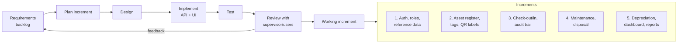

*Figure 3.1: Agile incremental development model adopted for the project*
*Source: Authors' design, based on Beck et al. (2001) and Abrahamsson et al. (2002).*

### 3.2 REQUIREMENTS ANALYSIS

#### 3.2.1 Requirements gathering

Requirements were gathered from four sources:

- informal interviews with administrative, finance and IT staff, who are the people who record, value and maintain assets;
- examination of existing asset spreadsheets and paper registers;
- hands-on review of an existing open-source tool, Snipe-IT (Grokability, n.d.);
- the literature reviewed in Chapter Two.

#### 3.2.2 Stakeholders and users

The system has three classes of user, implemented as roles:

- **Administrator:** has full control, including user and reference-data management.
- **Manager:** for example the facilities, admin or IT officer. Creates and edits assets, checks assets out and in, manages maintenance and disposes of assets.
- **Staff:** ordinary employees. Can view the register, their own assignments and asset details (for example after scanning a QR label), but cannot change data.

#### 3.2.3 Functional requirements

Table 3.1 lists the functional requirements, that is, what the system must do.

**Table 3.1: Functional requirements**

| ID | Requirement | Priority |
|---|---|---|
| FR1 | The system shall authenticate users with a username and password and issue a token for subsequent requests. | High |
| FR2 | The system shall restrict write operations to administrators and managers; staff shall have read-only access. | High |
| FR3 | The system shall allow managers to create, view, update and delete asset categories (with default useful life), locations and departments. | High |
| FR4 | The system shall register assets with name, category, serial number, vendor, purchase date, purchase cost, salvage value, depreciation method, useful life, location, department, condition and notes. | High |
| FR5 | The system shall automatically assign each new asset a unique, sequential, read-only tag of the form AST-0001. | High |
| FR6 | The system shall let users search assets by name, tag, serial number or vendor, and filter by status, category, department, location and custodian. | High |
| FR7 | The system shall generate a QR code image for each asset that encodes the URL of the asset's scan page. | High |
| FR8 | The system shall resolve a scanned tag to the corresponding asset record. | High |
| FR9 | The system shall allow an available asset to be checked out to a named user with an optional due date and note, setting its status to "assigned". | High |
| FR10 | The system shall allow an assigned asset to be checked in, recording the return condition, and set its status to "available". | High |
| FR11 | The system shall keep a complete assignment (custody) history for every asset. | High |
| FR12 | The system shall record preventive and corrective maintenance jobs with title, scheduled date, cost, vendor, status and notes. | High |
| FR13 | The system shall flag a maintenance job as overdue when its scheduled date has passed and it is not done. | High |
| FR14 | The system shall set an asset's status to "maintenance" when a job is in progress and restore it when the job is completed. | Medium |
| FR15 | The system shall compute each asset's current book value and accumulated depreciation by straight-line or declining-balance method. | High |
| FR16 | The system shall produce a full year-by-year depreciation schedule for each asset. | High |
| FR17 | The system shall allow an asset to be disposed of (sold, donated, scrapped or lost) with a reason and optional proceeds, setting its status to "retired". | High |
| FR18 | The system shall record every create, update, delete, check-out, check-in, maintenance and disposal action in an audit log with actor and timestamp. | High |
| FR19 | The system shall display a timeline of all events for each asset. | Medium |
| FR20 | The system shall display a dashboard of totals, value, status breakdown, assets by category and department, value trend, upcoming maintenance and recent activity. | Medium |
| FR21 | The system shall export the (optionally filtered) asset register as a CSV file. | Medium |

#### 3.2.4 Non-functional requirements

Table 3.2 lists the non-functional requirements, that is, the qualities the system must have.

**Table 3.2: Non-functional requirements**

| ID | Category | Requirement |
|---|---|---|
| NFR1 | Usability | The interface shall be simple enough for office staff with basic computer skills; target mean SUS score ≥ 68. |
| NFR2 | Responsiveness | The interface shall work on desktop and mobile browsers; the QR scan page shall be usable on a smartphone. |
| NFR3 | Performance | Common pages (register, asset detail, dashboard) shall load within 3 seconds on the office network for a register of several thousand assets; a scanned QR label shall open the asset record within 5 seconds. |
| NFR4 | Security | Passwords shall be stored hashed; all API requests except login and QR images shall require a valid token; role permissions shall be enforced on the server. |
| NFR5 | Integrity | Status transitions (check-out, check-in, disposal) shall be atomic database transactions; invalid transitions shall be rejected. |
| NFR6 | Accountability | No change to asset data shall occur without an audit log entry. |
| NFR7 | Accuracy | Money shall be handled as fixed-point decimals rounded to two places (kobo); depreciation shall never take book value below salvage value. |
| NFR8 | Maintainability | The code shall follow a layered structure (models, services, serializers, views) with automated tests. |
| NFR9 | Portability | The system shall run on any operating system with Python and a modern browser and use only open-source components. |
| NFR10 | Availability | The system shall be deployable on a single office server or low-cost cloud host. |

#### 3.2.5 User roles and permissions

Table 3.3 summarises the permissions of each role.

**Table 3.3: User roles and permissions**

| Function | Admin | Manager | Staff |
|---|---|---|---|
| Log in, view dashboard, register, asset details, QR scan page | ✓ | ✓ | ✓ |
| View audit log, maintenance, assignments, reports (CSV) | ✓ | ✓ | ✓ |
| Create / edit / delete assets | ✓ | ✓ | ✗ |
| Check out / check in assets | ✓ | ✓ | ✗ |
| Schedule and update maintenance | ✓ | ✓ | ✗ |
| Dispose of assets | ✓ | ✓ | ✗ |
| Manage categories, locations, departments | ✓ | ✓ | ✗ |
| Manage user accounts and roles (administration site) | ✓ | ✗ | ✗ |

Table 3.3 shows that every role can see the whole register, which supports transparency. Only managers and administrators can change data, and only administrators can manage user accounts.

### 3.3 SYSTEM ARCHITECTURE

The system uses a **three-tier client–server architecture** with a RESTful interface between the tiers, as shown in Figure 3.2.

1. **Presentation tier:** a React single-page application (SPA) running in the user's browser. It renders the user interface, keeps the authentication token, and calls the API with JSON over HTTP(S).
2. **Application tier:** a Django application exposing a REST API built with Django REST Framework (DRF). It is organised in four layers:
   - **models:** the data structure and depreciation properties;
   - **services:** state transitions such as check-out, check-in, disposal and maintenance status, each wrapped in a database transaction and writing an audit entry;
   - **serializers:** validation and JSON representation;
   - **views:** endpoints and permissions.

   A pure-Python depreciation module performs all valuation arithmetic. A QR module generates label images.
3. **Data tier:** a relational database accessed through the Django object-relational mapper (ORM). SQLite is used in development, and PostgreSQL can be configured for deployment through a database URL.

REST was chosen because its constraints of statelessness, a uniform interface and a client–server separation emphasise "scalability of component interactions, generality of interfaces, independent deployment of components" (Fielding, 2000). This allows the front end and back end to be built and deployed independently. In the future, the same API could serve a mobile app.

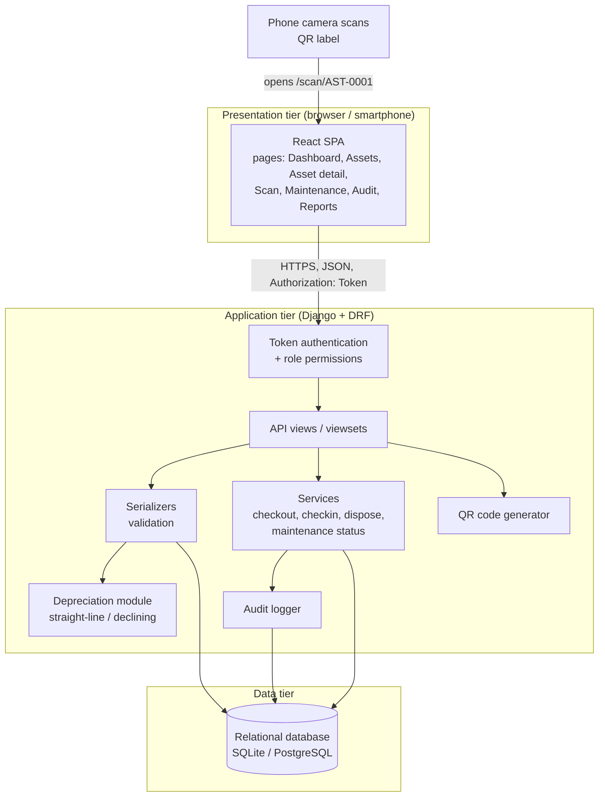

*Figure 3.2: Three-tier architecture of the asset management system*

As Figure 3.2 shows, the browser never accesses the database directly. Every request passes through token authentication and role permission checks. Every state-changing request passes through the service layer, which updates the asset and writes the audit log in one transaction.

### 3.4 SYSTEM MODELLING

The system was modelled with the Unified Modelling Language (UML) and an entity–relationship diagram.

#### 3.4.1 Use case diagram

Figure 3.3 shows the main use cases and the actors who perform them. Staff can only view and scan. Managers inherit the staff use cases and add all asset-changing operations. Administrators inherit the manager use cases and add user management.

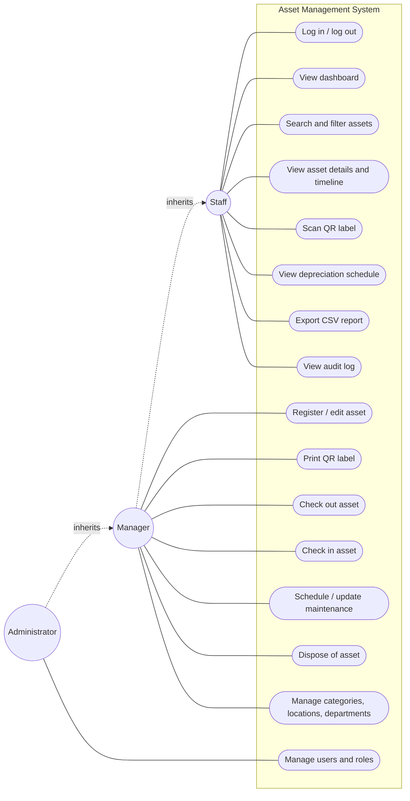

*Figure 3.3: Use case diagram of the asset management system*

#### 3.4.2 Entity–relationship diagram

Figure 3.4 shows the entities and their relationships. The central entity is **Asset**:

- Each asset belongs to exactly one **Category** and may belong to one **Location** and one **Department**.
- An asset may currently be held by one **User**.
- An asset has many **Assignment** records (custody history), many **Maintenance** records and many **AuditLog** entries, and at most one **Disposal** record.

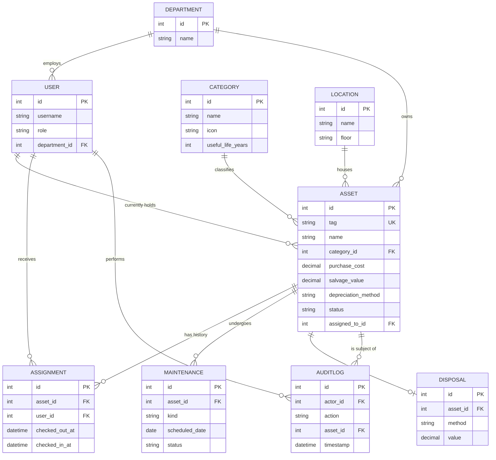

*Figure 3.4: Entity–relationship diagram (ERD) of the asset management system*

#### 3.4.3 Class diagram

Figure 3.5 shows the main classes of the domain model and their key attributes and operations. The **Asset** class holds the valuation operations (`value_on`, `current_value`, `depreciation_schedule`) and delegates the arithmetic to the stateless **Depreciation** module. The **AssetService** functions carry out the state transitions.

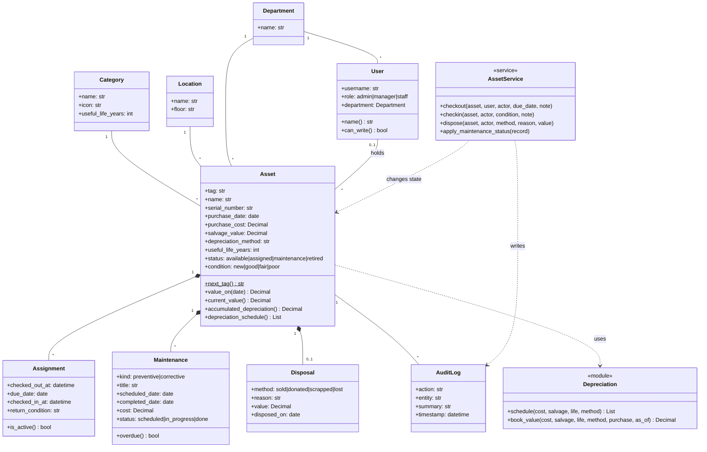

*Figure 3.5: Class diagram of the core domain*

#### 3.4.4 Sequence diagram: asset check-out

Figure 3.6 shows the interactions when a manager checks an asset out to a member of staff. The request is authenticated and authorised before the service layer validates that the asset is available and has no active assignment. Creating the assignment, updating the asset and writing the audit entry all happen in a single database transaction. If the asset is not available, the API returns HTTP 400 and nothing is changed.

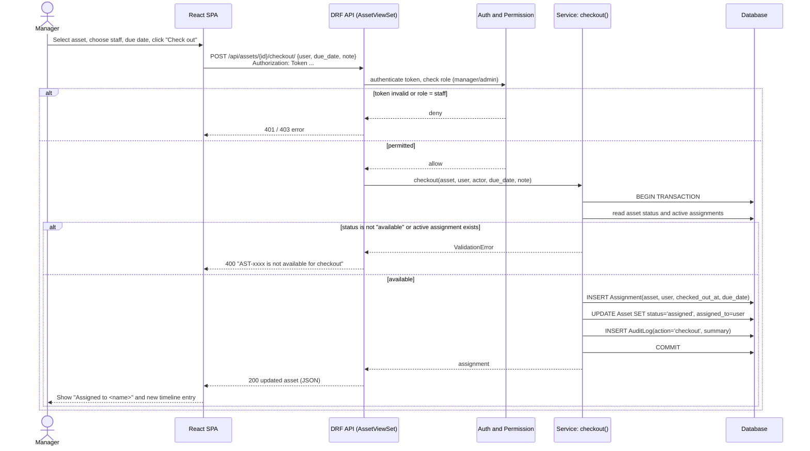

*Figure 3.6: Sequence diagram for asset check-out*

#### 3.4.5 Activity diagram: maintenance scheduling and completion

Figure 3.7 shows the maintenance workflow:

1. A manager schedules a preventive or corrective job.
2. Each day the system compares the scheduled date with the current date and flags the job as overdue if it has passed and the job is not done.
3. When work starts, the job and the asset move to "in progress" and "maintenance".
4. When the job is marked done, the completion date is set. The asset returns to "assigned" if it still has an active custodian, or to "available" otherwise.

Every step is written to the audit log.

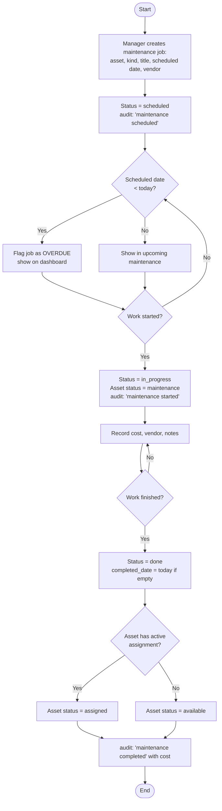

*Figure 3.7: Activity diagram for maintenance scheduling and completion*

#### 3.4.6 State diagram: asset status

Figure 3.8 summarises the life of an asset as a state machine. The four statuses are available, assigned, maintenance and retired. The diagram shows the operations that move an asset between them. "Retired" is a final state: once disposed of, an asset stops depreciating and cannot be checked out.

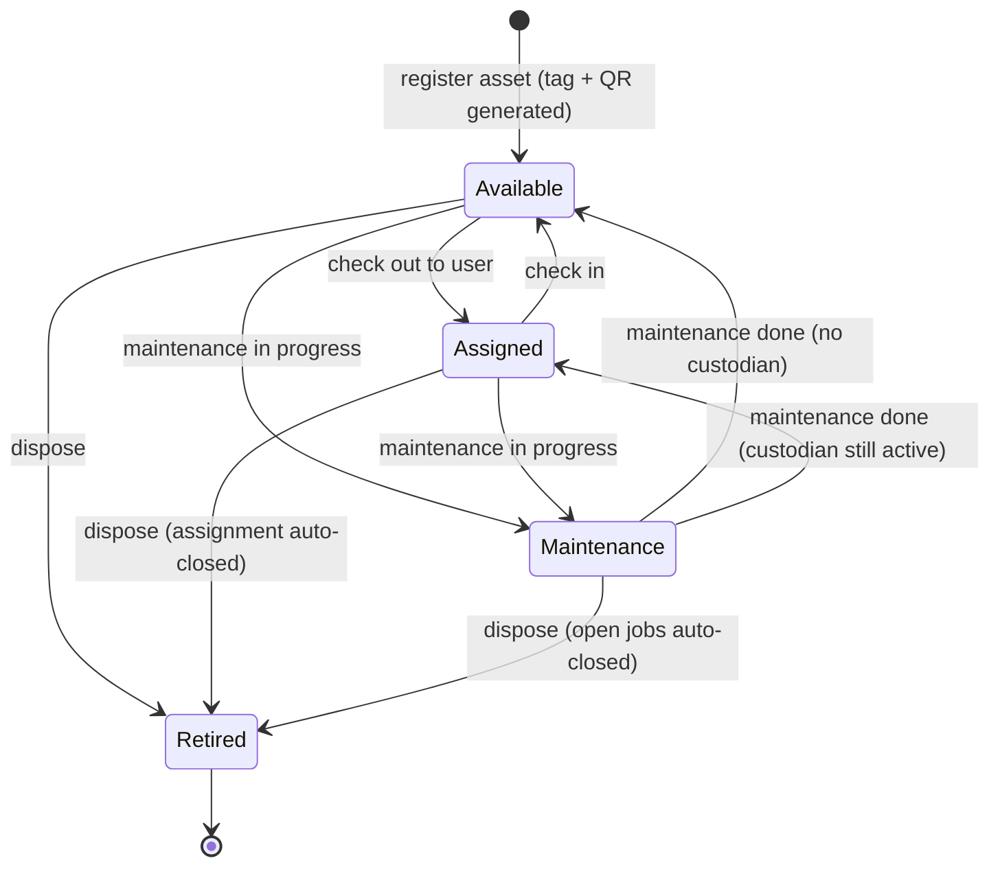

*Figure 3.8: State diagram of asset status*

### 3.5 DATABASE DESIGN

The logical design in Figure 3.4 was turned into the physical tables described in Tables 3.4 to 3.10. Django's ORM generates the tables from model classes. Every table has an auto-incrementing integer primary key `id`. Money columns use fixed-point `DECIMAL(14,2)` to avoid floating-point rounding errors.

**Table 3.4: Structure of the User table**

| Field | Data type | Constraint | Description |
|---|---|---|---|
| id | Integer | Primary key | Unique identifier |
| username | Varchar(150) | Unique, not null | Login name |
| password | Varchar(128) | Not null | Salted password hash (never plain text) |
| first_name, last_name | Varchar(150) | | User's names |
| email | Varchar(254) | | E-mail address |
| role | Varchar(10) | admin / manager / staff | Organisational role controlling permissions |
| department_id | Integer | Foreign key → Department, nullable | Home department |
| is_active | Boolean | | Whether the account can log in |

Table 3.4 extends Django's standard user model with a `role` and a home `department`.

**Table 3.5: Structure of the Asset table**

| Field | Data type | Constraint | Description |
|---|---|---|---|
| id | Integer | Primary key | Unique identifier |
| tag | Varchar(20) | Unique, auto-generated, read-only | Asset tag, e.g. AST-0001 |
| name | Varchar(200) | Not null | Descriptive name, e.g. "HP EliteBook 840 G8" |
| category_id | Integer | Foreign key → Category, protected | Asset category |
| serial_number | Varchar(100) | | Manufacturer's serial number |
| vendor | Varchar(150) | | Supplier |
| purchase_date | Date | Not null | Date of acquisition (start of depreciation) |
| purchase_cost | Decimal(14,2) | Not null | Cost in NGN |
| salvage_value | Decimal(14,2) | Default 0 | Residual value in NGN |
| depreciation_method | Varchar(20) | straight_line / declining_balance | Valuation method |
| useful_life_years | Integer | Nullable (defaults from category) | Useful life in years |
| location_id | Integer | Foreign key → Location, nullable | Current location |
| department_id | Integer | Foreign key → Department, nullable | Owning department |
| status | Varchar(20) | available / assigned / maintenance / retired | Lifecycle status |
| condition | Varchar(10) | new / good / fair / poor | Physical condition |
| assigned_to_id | Integer | Foreign key → User, nullable | Current custodian |
| assigned_since | Date | Nullable | Date of current check-out |
| notes | Text | | Free-text notes |
| created_at, updated_at | DateTime | | Record timestamps |

Table 3.5 is the core of the database. `current_value` and `accumulated_depreciation` are deliberately **not** stored. They are computed whenever they are requested, so they are always correct for the current date.

**Table 3.6: Structure of the Assignment table**

| Field | Data type | Constraint | Description |
|---|---|---|---|
| id | Integer | Primary key | Unique identifier |
| asset_id | Integer | Foreign key → Asset | Asset checked out |
| user_id | Integer | Foreign key → User | Custodian receiving the asset |
| checked_out_by_id | Integer | Foreign key → User, nullable | Manager who issued it |
| checked_out_at | DateTime | Not null | Time of check-out |
| due_date | Date | Nullable | Expected return date |
| checked_in_at | DateTime | Nullable (null = still active) | Time of return |
| note | Text | | Notes on issue/return |
| return_condition | Varchar(10) | new / good / fair / poor | Condition on return |

**Table 3.7: Structure of the Maintenance table**

| Field | Data type | Constraint | Description |
|---|---|---|---|
| id | Integer | Primary key | Unique identifier |
| asset_id | Integer | Foreign key → Asset | Asset being maintained |
| kind | Varchar(20) | preventive / corrective | Type of maintenance |
| title | Varchar(200) | Not null | Short description, e.g. "Quarterly servicing" |
| scheduled_date | Date | Not null | Planned date |
| completed_date | Date | Nullable | Actual completion date |
| cost | Decimal(14,2) | Default 0 | Cost in NGN |
| vendor | Varchar(150) | | Service provider |
| status | Varchar(20) | scheduled / in_progress / done | Job status |
| notes | Text | | Notes |

Overdue status is derived rather than stored: a job is overdue when its status is not "done" and its scheduled date is earlier than today.

**Table 3.8: Structure of the Disposal table**

| Field | Data type | Constraint | Description |
|---|---|---|---|
| id | Integer | Primary key | Unique identifier |
| asset_id | Integer | Foreign key → Asset, unique (one-to-one) | Asset disposed of |
| method | Varchar(10) | sold / donated / scrapped / lost | Disposal method |
| reason | Text | Not null | Justification |
| value | Decimal(14,2) | Nullable | Proceeds, if any |
| disposed_on | Date | Not null | Disposal date (depreciation stops here) |
| disposed_by_id | Integer | Foreign key → User, nullable | Officer who approved/recorded it |

**Table 3.9: Structure of the AuditLog table**

| Field | Data type | Constraint | Description |
|---|---|---|---|
| id | Integer | Primary key | Unique identifier |
| actor_id | Integer | Foreign key → User, nullable | User who performed the action ("System" if null) |
| action | Varchar(20) | create / update / delete / checkout / checkin / dispose / maintenance | Type of action |
| entity | Varchar(50) | | Entity affected, e.g. "asset", "maintenance" |
| entity_id | Big integer | Nullable | Identifier of the affected record |
| asset_id | Integer | Foreign key → Asset, nullable | Asset concerned (drives the asset timeline) |
| title | Varchar(200) | | Short title for timeline display |
| summary | Text | Not null | Human-readable description of the change |
| timestamp | DateTime | Indexed | When the action occurred |

**Table 3.10: Structure of the reference tables (Category, Location, Department)**

| Table | Field | Data type | Description |
|---|---|---|---|
| Category | name | Varchar(100), unique | e.g. Laptops, Printers, Furniture, Vehicles |
| Category | icon | Varchar(50) | Icon name for display |
| Category | useful_life_years | Integer, default 5 | Default useful life for assets in the category |
| Location | name | Varchar(100), unique | e.g. Head Office – 2nd Floor |
| Location | floor | Varchar(20) | Floor |
| Department | name | Varchar(100), unique | e.g. Finance, ICT, Human Resources |

Tables 3.6 to 3.10 hold the history and reference data around the asset. The design keeps history append-only: assignments are closed by setting `checked_in_at` rather than being deleted, and audit entries are never edited. This preserves a complete, verifiable record, in line with the assurance principle of ISO 55000.

### 3.6 API DESIGN

The back end exposes a REST API under `/api/`. Table 3.11 lists its main endpoints. All requests except login and QR images carry the header `Authorization: Token <key>`. Read requests are open to every authenticated user, while write requests need the manager or admin role. Otherwise the server responds with HTTP 403.

**Table 3.11: Summary of REST API endpoints**

| Method | Endpoint | Purpose |
|---|---|---|
| POST | /auth/login/ | Authenticate; return token and user profile |
| GET | /auth/me/ | Current user profile |
| POST | /auth/logout/ | Invalidate token |
| GET, POST, PUT, DELETE | /categories/, /locations/, /departments/ | Reference data |
| GET | /people/ | List of users with number of assets held |
| GET, POST | /assets/?search=&status=&category=&department=&location=&assigned_to= | List (with search and filters) / create assets |
| GET, PUT, PATCH, DELETE | /assets/{id}/ | Retrieve / update / delete an asset |
| GET | /assets/by-tag/{tag}/ | Resolve a scanned tag to an asset |
| GET | /assets/{id}/qr/ | PNG QR code encoding {FRONTEND_URL}/scan/{tag} |
| GET | /assets/{id}/depreciation/ | Year-by-year depreciation schedule |
| GET | /assets/{id}/timeline/ | Event history of the asset |
| POST | /assets/{id}/checkout/ | Check out to a user (400 if not available) |
| POST | /assets/{id}/checkin/ | Check in with return condition (400 if not assigned) |
| POST | /assets/{id}/dispose/ | Dispose (sold / donated / scrapped / lost) |
| GET | /assignments/?asset=&user=&active= | Custody history |
| GET, POST, PUT, PATCH, DELETE | /maintenance/?asset=&status= | Maintenance jobs (with computed `overdue`) |
| GET | /audit/?limit= | Audit log, newest first |
| GET | /dashboard/ | Aggregated dashboard data |
| GET | /reports/assets.csv | CSV export of the (filtered) register |

### 3.7 EVALUATION DESIGN

The system was evaluated in two ways:

1. **Functional testing.** Each functional requirement in Table 3.1 was mapped to one or more test cases with defined inputs and expected results. The test cases were executed against the running system and the actual results recorded (Section 4.5). The depreciation module was also tested on its own with known worked examples (Table 2.2).
2. **Usability evaluation.** The System Usability Scale (Brooke, 1996) was used.
   - **Participants:** about [NUMBER] office staff from [CASE-STUDY OFFICE / ORGANISATION NAME].
   - **Procedure:** each participant first completed seven representative tasks: log in, search for an asset, scan a QR label, check an asset out and in, schedule maintenance, view depreciation, and export a report. They then completed the questionnaire in Appendix B.
   - **Analysis:** responses were scored using the standard SUS method. The results are reported as frequency tables, item means and an overall mean SUS score, and interpreted against the average of 68 (Sauro, 2011) and the adjective scale of Bangor et al. (2009).


# CHAPTER FOUR

## SYSTEM IMPLEMENTATION, TESTING AND RESULTS

This chapter describes how the design in Chapter Three was implemented. Section 4.1 gives the tools used and Section 4.2 the modules built. Section 4.3 explains the key algorithms and Section 4.4 the user interface. Sections 4.5 and 4.6 present the results of functional testing and the usability evaluation, and Section 4.7 discusses the results.

### 4.1 IMPLEMENTATION ENVIRONMENT AND TOOLS

Table 4.1 lists the tools and technologies used to implement the system and the reasons for choosing each.

**Table 4.1: Implementation tools and justification**

| Component | Tool / version | Justification |
|---|---|---|
| Back-end language | Python 3 | Readable, widely taught, rich ecosystem; the team's strongest language |
| Web framework | Django 6.1 | Mature "batteries-included" framework with an ORM, migrations, authentication, password hashing and an admin site (Django Software Foundation, n.d.) |
| API framework | Django REST Framework 3.18 | Serializers, viewsets, routers, token authentication and permission classes for building Web APIs quickly (Django REST framework, n.d.) |
| QR generation | `qrcode` 8.2 with Pillow | Generates standard QR symbols (ISO/IEC, 2024) as PNG images on the server |
| Database | SQLite (development); PostgreSQL via `dj-database-url` (deployment) | Zero-configuration local database; the same code runs on a production database by changing one URL |
| Cross-origin support | django-cors-headers | Allows the SPA served from a different origin to call the API |
| Front-end library | React 19 with TypeScript | Component-based UI (Meta Platforms, n.d.); static typing catches errors early |
| Build tool | Vite | Fast development server and optimised production builds |
| Styling | Tailwind CSS 4 | Utility-first CSS for a consistent, responsive design |
| Routing | React Router 7 | Client-side routes, including the `/scan/:tag` route opened by QR labels |
| Icons and charts | Phosphor Icons; custom chart components | Category icons and dashboard visualisations |
| Version control | Git and GitHub | Collaboration, history and code submission ([GITHUB REPOSITORY LINK]) |
| Hardware used | [e.g. laptop specification: processor, RAM, OS] | Development and testing machine(s) |

Table 4.1 shows that the system uses only free and open-source components. No licence cost is passed on to the adopting office, which addresses one of the barriers identified in Table 2.3.

### 4.2 MODULE IMPLEMENTATION

The back end is a Django project with two applications:

- **`accounts`:** users, roles, departments and authentication.
- **`assets`:** categories, locations, assets, assignments, maintenance, disposals, the audit log, depreciation, the dashboard and reports.

The front end is a React SPA whose pages correspond to the modules below.

#### 4.2.1 Authentication and access-control module

**Login.** Users log in with a username and password (`POST /api/auth/login/`). The server verifies the password against its salted hash and returns a DRF authentication token with the user's profile and role. The SPA stores the token and sends it in the `Authorization` header of every request.

**Write permission.** A custom permission class, `IsManagerOrReadOnly`, lets any authenticated user perform safe (read) requests. It allows unsafe requests (POST, PUT, PATCH, DELETE) only when the user's role is manager or admin, and otherwise returns HTTP 403 with the message "Your role is read-only". The user interface also hides editing controls from staff. Permissions are always enforced on the server as well, so they cannot be bypassed by calling the API directly (NFR4).

**CSV downloads.** So that a CSV report can be downloaded by an ordinary browser link, a small authentication class also accepts the token as a `?token=` query parameter on the report endpoint.

#### 4.2.2 Asset register module

The `Asset` model stores the fields listed in Table 3.5. When a new asset is saved without a tag, the model generates the next sequential tag. It finds the highest existing number among tags of the form `AST-nnnn` and adds one, giving AST-0001, AST-0002 and so on (FR5). If no useful life is entered, the asset inherits the default useful life of its category.

The register endpoint supports:

- a free-text `search` across name, tag, serial number and vendor;
- exact filters on status, category, department, location and custodian (FR6).

Every create, update and delete writes an audit entry.

#### 4.2.3 QR code module

For each asset, the endpoint `GET /api/assets/{id}/qr/` generates a PNG image of a QR code that encodes the URL `{FRONTEND_URL}/scan/{tag}`, for example `https://assets.example.com/scan/AST-0005`. The image needs no authentication, so it can be shown directly in an `` element and printed as a label.

When a staff member points a phone camera at the label, the phone opens the URL. The SPA's `/scan/:tag` route then calls `GET /api/assets/by-tag/{tag}/` and redirects to the asset's detail page (FR7, FR8). The label holds a URL rather than raw data, so it never goes out of date: the page always shows the asset's live status, custodian and value.

#### 4.2.4 Check-out / check-in module

Check-out and check-in are implemented as service functions, each wrapped in a database transaction (`@transaction.atomic`), as modelled in Figure 3.6.

**`checkout()`** first validates the request. It rejects it with HTTP 400 if the asset's status is not "available" or if an active assignment already exists. It then:

1. creates an `Assignment` record;
2. sets the asset's status to "assigned" and records the custodian and date;
3. writes an audit entry such as "AST-0005 HP EliteBook checked out to A. Bello, due back 30 Nov 2026".

**`checkin()`** closes the active assignment by setting `checked_in_at`, records the return condition and updates the asset's condition. It then returns the asset to "available", clears the custodian and writes an audit entry.

Because assignments are closed rather than deleted, the full custody history of each asset is preserved (FR9–FR11).

#### 4.2.5 Maintenance module

Maintenance jobs are full create/read/update/delete (CRUD) resources. The `overdue` property is computed on every read as:

> overdue = (status ≠ "done") AND (scheduled_date < today)

It is therefore always current and never needs a scheduled background job (FR13).

When a job's status changes, the function `apply_maintenance_status()` keeps the asset's status in step with it, as modelled in Figure 3.7:

- **"in progress":** the asset is set to "maintenance".
- **"done":** the completion date is set if it is empty. The asset returns to "assigned" if it still has an active custodian, or to "available" otherwise. It stays in maintenance if another job on it is still in progress.

Each change is logged, with the cost recorded on completion (FR12–FR14).

#### 4.2.6 Disposal module

`dispose()` validates the disposal method (sold, donated, scrapped or lost) and requires a reason. It then:

1. automatically closes any active assignment and any open maintenance jobs;
2. creates the `Disposal` record with the optional proceeds;
3. sets the asset's status to "retired";
4. writes an audit entry.

A retired asset stops depreciating on its disposal date (FR17). This gives the documented, controlled disposal trail whose absence Atiga et al. (2015) identified as a weakness.

#### 4.2.7 Audit trail and timeline module

A helper function `audit.log()` is called by every service and every create, update and delete operation. It records the actor, action, entity, affected asset, a short title, a human-readable summary and a timestamp (FR18, NFR6).

- `GET /api/audit/` returns the organisation-wide log, newest first.
- `GET /api/assets/{id}/timeline/` returns the events for one asset, which the asset detail page shows as a timeline (FR19).

#### 4.2.8 Dashboard and reports module

`GET /api/dashboard/` returns, in one request:

- totals: number of assets, total purchase value, current book value, and counts of assigned, available, in-maintenance, retired and overdue-maintenance items;
- breakdowns by category, department and status;
- a five-year trend of the book value of the whole asset base;
- the next five maintenance jobs;
- the eight most recent audit entries (FR20).

`GET /api/reports/assets.csv` streams the register as a CSV file named with the current date. It accepts the same filters as the register, so a manager can export, for example, only the ICT department's laptops (FR21).

### 4.3 KEY ALGORITHMS

#### 4.3.1 Depreciation schedule

The depreciation module is a set of pure Python functions with no dependency on Django, so it can be tested on its own. All money is handled as `Decimal` and rounded half-up to two decimal places (kobo), which avoids binary floating-point errors (NFR7). Algorithm 4.1 gives the schedule calculation in pseudocode.

**Algorithm 4.1: Depreciation schedule**

```text
INPUT : cost C, salvage S, useful life n (years), method M, start year Y
OUTPUT: list of rows (period, year, opening, depreciation, closing)

1.  IF S > C THEN S ← C
2.  IF n ≤ 0 THEN RETURN empty list
3.  opening ← C
4.  straight_charge ← (C − S) / n                 // Equation 2.1
5.  rate ← 2 / n                                  // Equation 2.3 (double-declining)
6.  FOR p ← 1 TO n DO
7.      IF p = n THEN charge ← opening − S        // final year: write down exactly to salvage
8.      ELSE IF M = straight_line THEN charge ← straight_charge
9.      ELSE charge ← opening × rate              // Equation 2.4
10.     charge ← round2( max(0, min(charge, opening − S)) )   // never below salvage
11.     closing ← opening − charge                // Equation 2.5
12.     APPEND (p, Y + p − 1, opening, charge, closing)
13.     opening ← closing
14. END FOR
15. RETURN rows
```

#### 4.3.2 Current book value on any date

The book value on a date is prorated within the current depreciation year:

1. Compute the elapsed years since purchase: *t* = (as_of − purchase_date) in days / 365.25.
2. If *t* is at least *n*, the book value is the salvage value.
3. Otherwise, take row ⌊*t*⌋ + 1 of the schedule and subtract the fraction (*t* − ⌊*t*⌋) of that year's charge from its opening value.

For straight-line depreciation this simplifies to BV = C − D × *t*. For retired assets, the valuation date is capped at the disposal date. Accumulated depreciation is computed as cost minus current book value.

#### 4.3.3 Sample output

Table 4.2 shows the schedules produced by the implemented module for the laptop example of Section 2.4.4: cost ₦850,000, salvage value ₦50,000, four-year life, purchased in 2023.

**Table 4.2: Depreciation schedule produced by the system for a sample asset**

| Year | Method | Opening (₦) | Depreciation (₦) | Closing (₦) |
|---|---|---|---|---|
| 2023 | Straight-line | 850,000.00 | 200,000.00 | 650,000.00 |
| 2024 | Straight-line | 650,000.00 | 200,000.00 | 450,000.00 |
| 2025 | Straight-line | 450,000.00 | 200,000.00 | 250,000.00 |
| 2026 | Straight-line | 250,000.00 | 200,000.00 | 50,000.00 |
| 2023 | Declining balance | 850,000.00 | 425,000.00 | 425,000.00 |
| 2024 | Declining balance | 425,000.00 | 212,500.00 | 212,500.00 |
| 2025 | Declining balance | 212,500.00 | 106,250.00 | 106,250.00 |
| 2026 | Declining balance | 106,250.00 | 56,250.00 | 50,000.00 |

*Source: Output of the system's depreciation module (run on 19 November 2026).*

The output in Table 4.2 matches the hand computation in Table 2.2 exactly. Both methods end at the salvage value of ₦50,000 and write off the same total of ₦800,000. In the final declining-balance year the charge (₦56,250) is larger than the 50% rate alone would give (₦53,125), because the remaining amount above salvage is written off in full. This is the final-year rule of Algorithm 4.1.

#### 4.3.4 Tag generation and overdue detection

- **Tag generation:** take the maximum numeric suffix of existing tags matching `AST-(\d+)`, add one, and pad to four digits.
- **Overdue detection:** the boolean expression given in Section 4.2.5.

Both are computed when needed rather than stored, so they cannot become inconsistent with the underlying data.

### 4.4 USER INTERFACE

This section presents the main screens of the implemented system. *[Screenshots to be inserted by the team. Replace each placeholder below with a screenshot of the running system, keeping the caption underneath.]*

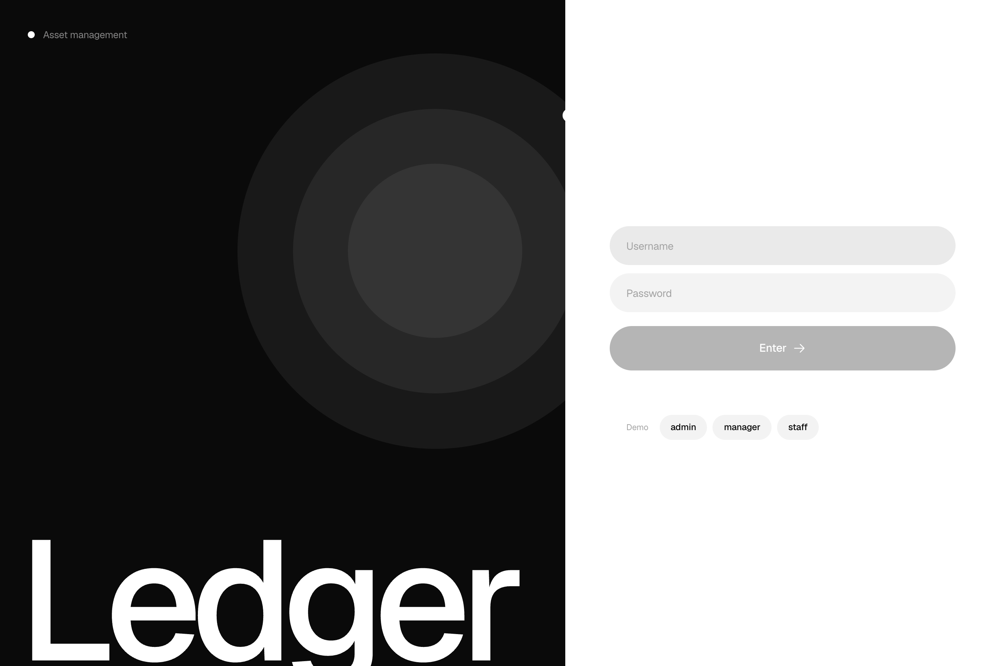

*Figure 4.1: Login page*

Figure 4.1 shows the login page. The user enters a username and password. Demonstration accounts are provided for each role (Appendix A).

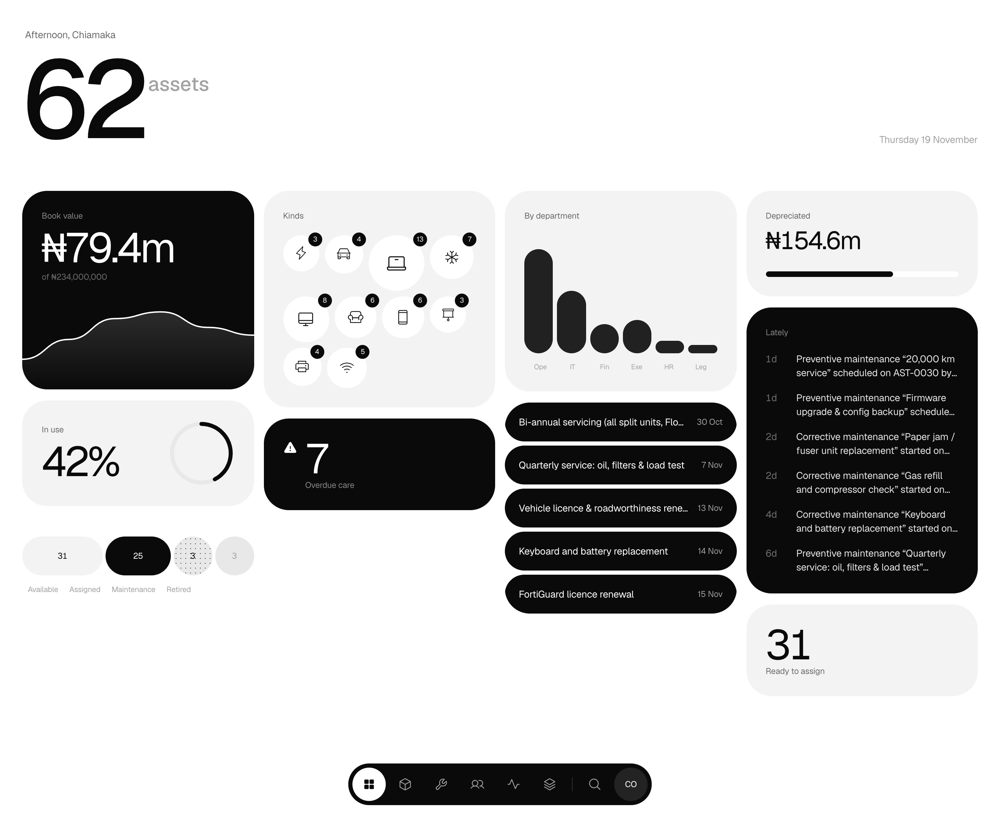

*Figure 4.2: Dashboard*

The dashboard in Figure 4.2 gives management an at-a-glance view of the asset base:

- total assets, purchase value and current book value;
- counts by status and the number of overdue maintenance jobs;
- charts by category and department, and the book-value trend;
- upcoming maintenance and recent activity.

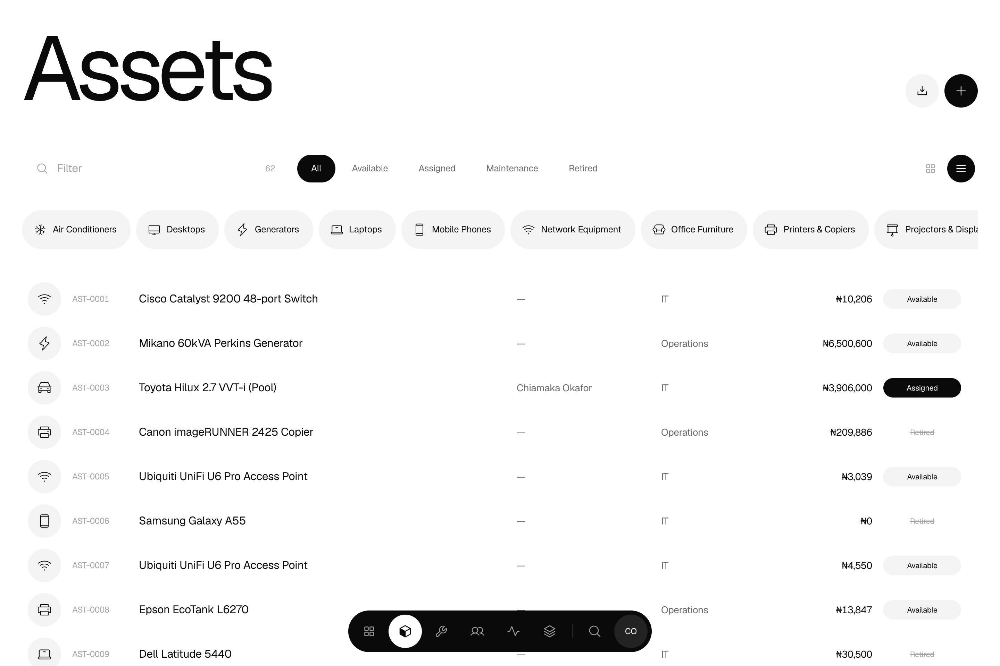

*Figure 4.3: Asset register with search and filters*

Figure 4.3 shows the asset register. Each row shows the tag, name, category, custodian, location, status and current value. The search box and filters narrow the list instantly.

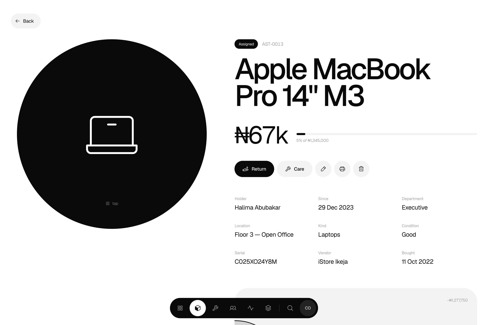

*Figure 4.4: Asset detail page with QR code, timeline and depreciation*

The asset detail page in Figure 4.4 brings together:

- the asset's details and QR code;
- its current custodian and value;
- its depreciation schedule;
- its full timeline of events.

From this page a manager can check the asset out or in, schedule maintenance or dispose of it.

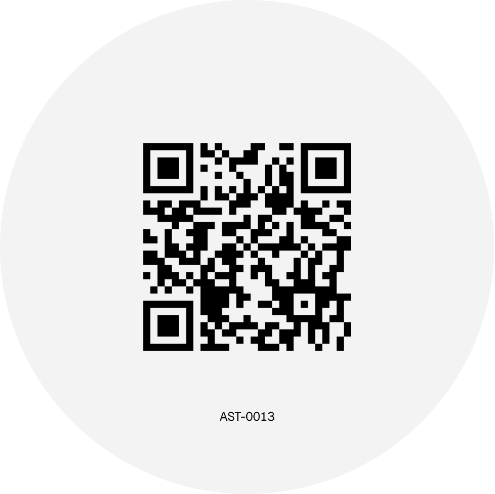

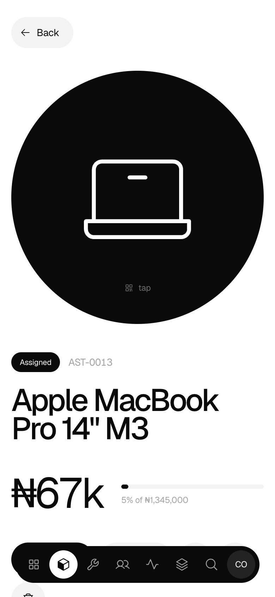

*Figure 4.5: Asset QR code (top) and the page opened on a smartphone after scanning it (bottom)*

Figure 4.5 shows the QR code generated for an asset (shown by tapping the asset image, and printable as a label) and the page that opens when the label is scanned with a smartphone. This is the feature that links the physical asset to its digital record.

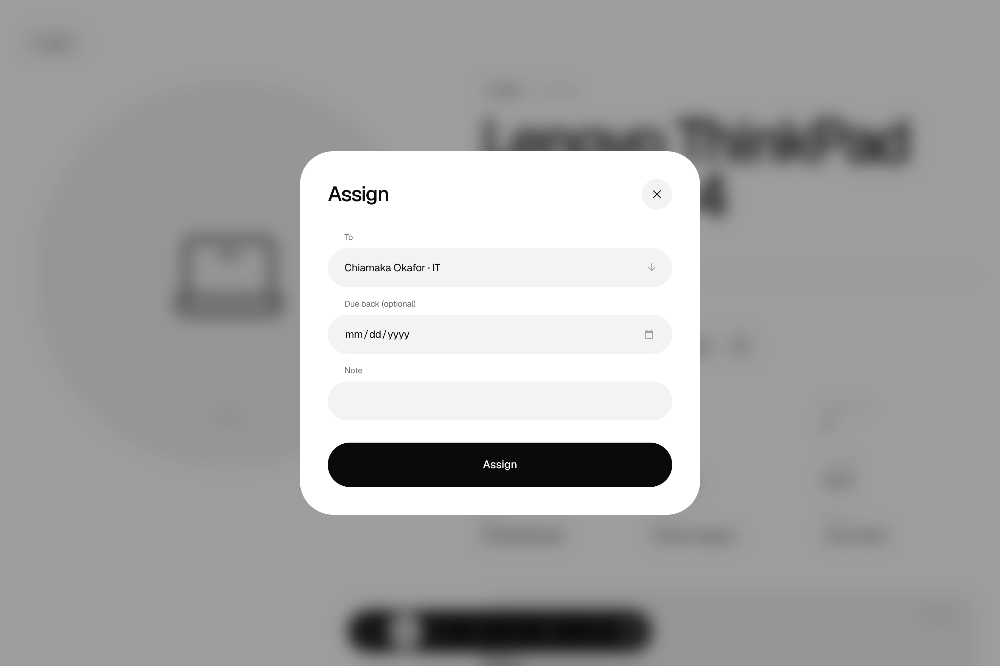

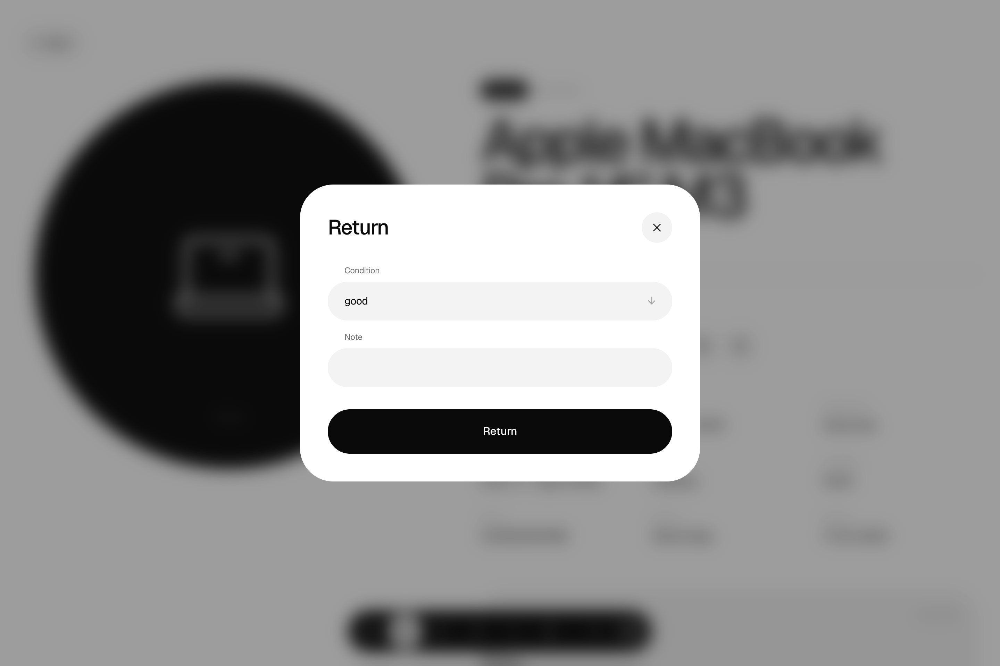

*Figure 4.6: Check-out (top) and check-in (bottom) dialogs*

Figure 4.6 shows the dialogs used to check an asset out (choose staff member, due date and note) and to check it in (record return condition).

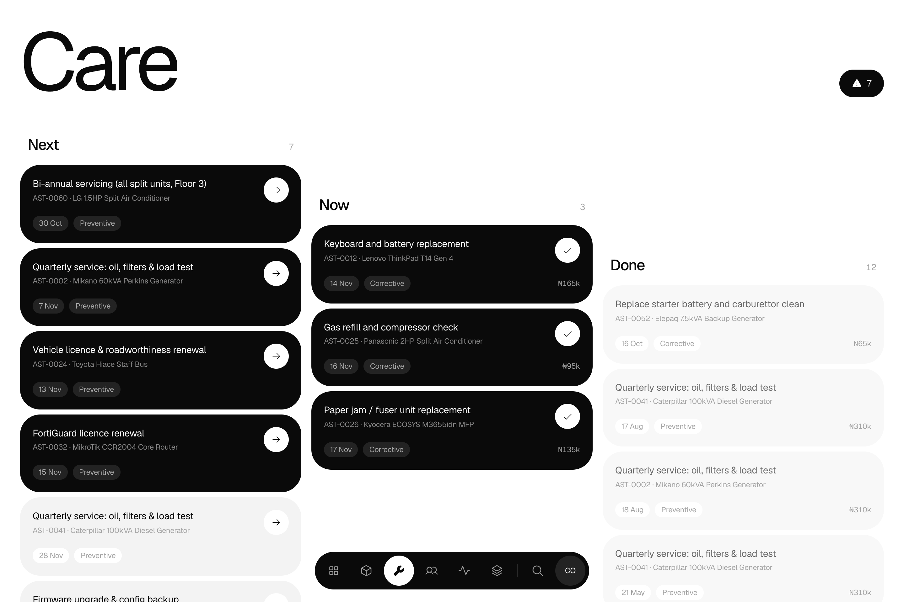

*Figure 4.7: Maintenance schedule showing an overdue job*

Figure 4.7 shows the maintenance schedule. Overdue jobs are highlighted so that they can be acted upon.

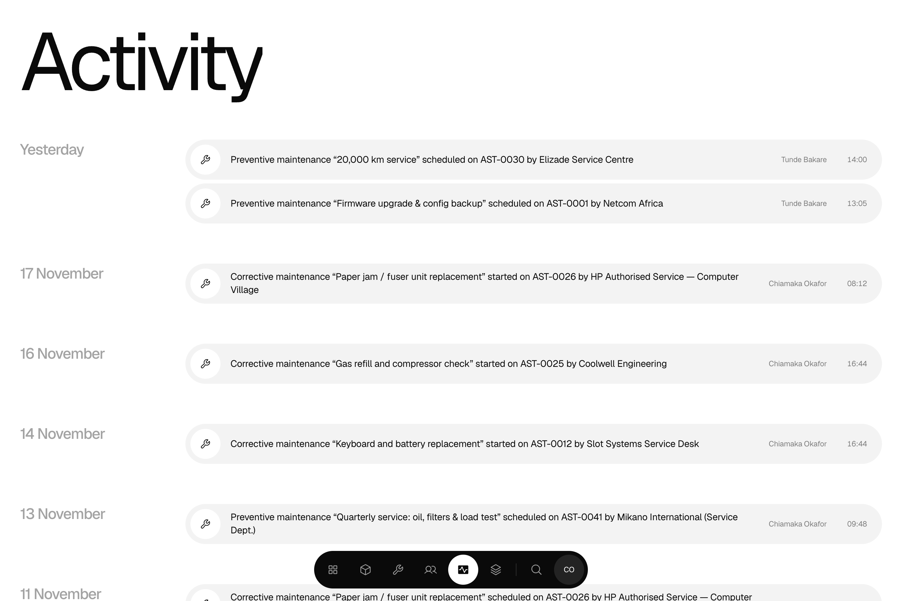

*Figure 4.8: Audit log*

Figure 4.8 shows the audit log. Every action is listed with the actor and time, giving a complete trail for internal and external audit.

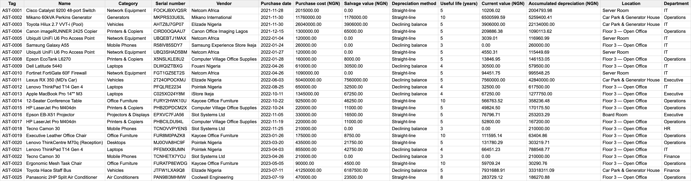

*Figure 4.9: Asset register exported as CSV and opened as a spreadsheet*

Figure 4.9 shows the asset register exported as CSV and opened in a spreadsheet for further analysis or for submission to the finance unit.

### 4.5 SYSTEM TESTING

The system was tested against the functional requirements of Table 3.1. Table 4.3 lists the test cases, the expected result of each and the actual result observed.

The tests were executed on 19 November 2026 against the running system (Django development server with the seeded demonstration data). TC1–TC8, TC10–TC16 and TC21–TC25 were run through the REST API with a scripted HTTP client, TC17–TC20 by running the depreciation module directly, and TC26 in a browser at smartphone size. TC9 requires a printed label and a physical phone.

**Table 4.3: Functional test cases and results**

| TC | Requirement | Test description / input | Expected result | Actual result | Status |
|---|---|---|---|---|---|
| TC1 | FR1 | Log in with valid credentials (manager / correct password) | Token returned; dashboard displayed | HTTP 200; token issued (40 chars); user role 'manager' | PASS |
| TC2 | FR1 | Log in with a wrong password | Error message displayed; no token issued | HTTP 400: "Invalid username or password."; no token in response | PASS |
| TC3 | FR1, NFR4 | Call GET /api/assets/ without a token | HTTP 401 Unauthorized | HTTP 401 | PASS |
| TC4 | FR2 | Staff user attempts to create an asset | HTTP 403 "Your role is read-only…"; no asset created | HTTP 403: "Your role is read-only. Ask a manager or admin to make this change."; asset count unchanged (62) | PASS |
| TC5 | FR4, FR5 | Manager creates a new asset without a tag | Asset saved with next sequential tag, e.g. AST-0026 | HTTP 201; tag AST-0063 (previous highest AST-0062) | PASS |
| TC6 | FR4 | Create asset with no useful life in a category whose default is 4 years | Asset's useful life set to 4 | Category 'Laptops' default 4 yrs; asset useful_life_years = 4 | PASS |
| TC7 | FR6 | Search "EliteBook" and filter status = assigned | Only assigned assets matching "EliteBook" listed | 3 results, all assigned and named EliteBook: True | PASS |
| TC8 | FR7 | Request GET /api/assets/{id}/qr/ | PNG image returned that decodes to {FRONTEND_URL}/scan/{tag} | HTTP 200, image/png; decodes to http://localhost:5173/scan/AST-0063 | PASS |
| TC9 | FR8, NFR3 | Scan the printed QR label with a smartphone | Asset detail page opens within 5 seconds | [TO BE RECORDED] | [PASS/FAIL] |
| TC10 | FR9 | Check out an available asset to a staff member with a due date | Status becomes "assigned"; custodian shown; timeline and audit entry created | HTTP 200; status 'assigned'; custodian Aisha Bello; timeline top 'checkout'; audit top 'checkout' | PASS |
| TC11 | FR9, NFR5 | Check out an asset that is already assigned | HTTP 400 "…is not available for checkout"; no change | HTTP 400: "AST-0063 is not available for checkout (status: assigned)."; status still 'assigned' | PASS |
| TC12 | FR10 | Check in an assigned asset with condition "fair" | Status "available"; condition "fair"; assignment closed | HTTP 200; status 'available'; condition 'fair'; assignment closed: True | PASS |
| TC13 | FR11 | View assignments for an asset checked out and in twice | Two closed assignment records with dates and users | 2 assignment records, all closed: True; users: Aisha Bello, Aisha Bello | PASS |
| TC14 | FR12, FR13 | Create a maintenance job dated yesterday with status "scheduled" | Job saved and flagged overdue = true; counted on dashboard | HTTP 201; overdue = True; dashboard overdue count 7 → 8 | PASS |
| TC15 | FR14 | Set a job on an available asset to "in progress" | Asset status becomes "maintenance" | HTTP 200; asset status 'maintenance' | PASS |
| TC16 | FR14 | Set the job to "done" | completed_date set to today; asset returns to "available" | HTTP 200; completed_date 2026-11-19 (today 2026-11-19); asset status 'available' | PASS |
| TC17 | FR16 | Straight-line schedule: cost ₦850,000, salvage ₦50,000, life 4 | Charges of ₦200,000 per year; closing value ₦50,000 | As expected (Table 4.2) | PASS |
| TC18 | FR16 | Declining-balance schedule for the same asset | Charges ₦425,000, ₦212,500, ₦106,250, ₦56,250; closing value ₦50,000 | As expected (Table 4.2) | PASS |
| TC19 | NFR7 | Salvage value greater than cost (cost ₦100,000, salvage ₦150,000, life 3) | Salvage capped at cost; no negative depreciation | All three annual charges ₦0.00; book value stays ₦100,000 | PASS |
| TC20 | FR15 | Current value of the sample laptop (straight-line) bought 19 Nov 2024, valued on 19 Nov 2026 | ≈ ₦850,000 − 2 × ₦200,000 = ₦450,000 (prorated by days) | Module: ₦450,273.79 (730 days ÷ 365.25 = 1.9986 years). [Confirm on asset detail page] | PASS (module) |
| TC21 | FR17 | Dispose of an assigned asset as "sold" for ₦100,000 with reason | Status "retired"; assignment closed; disposal recorded; value frozen | HTTP 200; status 'retired'; active assignments 0; current value ₦840,143.74 | PASS |
| TC22 | FR17 | Dispose of an already retired asset | HTTP 400 "…has already been disposed" | HTTP 400: "AST-0063 has already been disposed." | PASS |
| TC23 | FR18, FR19 | Perform create, check-out, check-in on an asset; open its timeline | All three events listed, newest first, with actor names | Timeline types (newest first): maintenance, maintenance, maintenance, checkin, checkout, checkin, checkout, created; sorted newest-first: True; actor names present: True | PASS |
| TC24 | FR20 | Open the dashboard | Totals equal the counts and sums in the register | Dashboard assets 63 = register 63; status counts match: True; purchase value ₦234,000,000 = register sum ₦234,000,000 | PASS |
| TC25 | FR21 | Export CSV with filter department = ICT | CSV downloaded containing only ICT assets | HTTP 200, text/csv; charset=utf-8; 17 rows, all department = IT: True | PASS |
| TC26 | NFR2 | Open the register and asset pages on a smartphone browser | Layout adapts to the small screen; all actions usable | Verified in Chrome device emulation at 390×844 px: grids collapse to 1–2 columns, navigation fits the screen, dialogs open as bottom sheets. [Team: confirm on a physical phone] | PASS |

Table 4.3 covers every functional requirement and the key non-functional requirements for security, integrity, accuracy and responsiveness.

- TC17 to TC20 confirm that the depreciation module reproduces the hand-computed results and respects the salvage constraint.
- 25 of the 26 test cases passed on first execution and none failed; TC9 (physical QR scan) is pending. *[Team: update once TC9 has been run on a phone.]*
- Access control behaved as designed: requests without a token were rejected (TC3), and a staff account could read but not modify data (TC4).
- State rules held: an assigned asset could not be checked out again (TC11), and a retired asset could not be disposed of twice (TC22).

### 4.6 USABILITY EVALUATION

#### 4.6.1 Instrument and procedure

Usability was measured with the System Usability Scale (Brooke, 1996).

- **Participants:** [NUMBER] staff of [CASE-STUDY OFFICE / ORGANISATION NAME], with roles ranging from administrative and finance officers to IT support staff.
- **Procedure:** each participant was given a short introduction and an account. They then performed the seven tasks in Section B of the questionnaire (Appendix B): log in, search for an asset, scan a QR label, check an asset out and in, schedule maintenance, view the depreciation schedule, and export a CSV report. Finally they completed the ten SUS items and the adjective rating item.
- **Dates:** the evaluation took place on [DATES OF EVALUATION].

#### 4.6.2 SUS items and scoring

Table 4.4 lists the ten SUS items and how each is scored.

**Table 4.4: System Usability Scale items and scoring rule**

| No. | Statement | Scoring |
|---|---|---|
| 1 | I think that I would like to use this system frequently. | response − 1 |
| 2 | I found the system unnecessarily complex. | 5 − response |
| 3 | I thought the system was easy to use. | response − 1 |
| 4 | I think that I would need the support of a technical person to be able to use this system. | 5 − response |
| 5 | I found the various functions in this system were well integrated. | response − 1 |
| 6 | I thought there was too much inconsistency in this system. | 5 − response |
| 7 | I would imagine that most people would learn to use this system very quickly. | response − 1 |
| 8 | I found the system very cumbersome to use. | 5 − response |
| 9 | I felt very confident using the system. | response − 1 |
| 10 | I needed to learn a lot of things before I could get going with this system. | 5 − response |

*Source: Brooke (1996).*

Each item is answered on a five-point scale (1 = strongly disagree to 5 = strongly agree). As Table 4.4 shows, odd-numbered (positive) items score the response minus one, and even-numbered (negative) items score five minus the response. Each item therefore contributes 0 to 4. The ten contributions are summed and multiplied by 2.5, giving an overall score from 0 to 100:

> SUS = 2.5 × [ Σ(odd items: response − 1) + Σ(even items: 5 − response) ]  (Equation 4.1)

For example, the responses 4, 2, 5, 1, 4, 2, 5, 2, 4, 1 give (3 + 4 + 3 + 4 + 3) + (3 + 4 + 3 + 3 + 4) = 34, and 34 × 2.5 = 85.0. A SUS score is not a percentage. It is interpreted against benchmarks: the average across many studies is 68 (Sauro, 2011), and adjective ratings help explain what a score means (Bangor et al., 2009).

#### 4.6.3 Results

> **IMPORTANT — PLACEHOLDER DATA:** All numbers in Tables 4.5 to 4.11 below are **placeholders** marked "[ ]". They are **not real results**. Replace them with the actual responses collected with the questionnaire in Appendix B before submission, and rewrite the discussion to match.

**Table 4.5: Demographic profile of respondents (PLACEHOLDER — replace with real data)**

| Variable | Category | Frequency | Percentage |
|---|---|---|---|
| Role | Manage/record assets | [ ] | [ ]% |
| Role | Use assigned assets only | [ ] | [ ]% |
| Role | Supervisor / head of unit | [ ] | [ ]% |
| Computer use at work | Daily | [ ] | [ ]% |
| Computer use at work | A few times a week or less | [ ] | [ ]% |
| Current recording method | Paper registers | [ ] | [ ]% |
| Current recording method | Spreadsheets | [ ] | [ ]% |
| Current recording method | Dedicated software / not sure | [ ] | [ ]% |
| **Total respondents** | | **[N]** | **100%** |

Table 4.5 describes the respondents. *[Team: describe the sample, for example how many respondents currently use spreadsheets, as this supports the problem statement in Section 1.2.]*

**Table 4.6: Responses to "I thought the system was easy to use" (SUS item 3) (PLACEHOLDER — replace with real data)**

| Response | Frequency | Percentage |
|---|---|---|
| Strongly Agree | [ ] | [ ]% |
| Agree | [ ] | [ ]% |
| Neutral | [ ] | [ ]% |
| Disagree | [ ] | [ ]% |
| Strongly Disagree | [ ] | [ ]% |
| **Total** | **[N]** | **100%** |

Table 4.6 shows how respondents rated the system's ease of use. *[Team: interpret, e.g. "X% of respondents agreed or strongly agreed that the system was easy to use".]*

**Table 4.7: Responses to "I think that I would like to use this system frequently" (SUS item 1) (PLACEHOLDER — replace with real data)**

| Response | Frequency | Percentage |
|---|---|---|
| Strongly Agree | [ ] | [ ]% |
| Agree | [ ] | [ ]% |
| Neutral | [ ] | [ ]% |
| Disagree | [ ] | [ ]% |
| Strongly Disagree | [ ] | [ ]% |
| **Total** | **[N]** | **100%** |

Table 4.7 indicates how willing respondents are to adopt the system. *[Team: interpret.]*

**Table 4.8: Responses to "I think that I would need the support of a technical person to be able to use this system" (SUS item 4) (PLACEHOLDER — replace with real data)**

| Response | Frequency | Percentage |
|---|---|---|
| Strongly Agree | [ ] | [ ]% |
| Agree | [ ] | [ ]% |
| Neutral | [ ] | [ ]% |
| Disagree | [ ] | [ ]% |
| Strongly Disagree | [ ] | [ ]% |
| **Total** | **[N]** | **100%** |

Item 4 is a negative statement, so disagreement is the favourable response. Table 4.8 shows whether users felt they could use the system without technical help. *[Team: interpret.]*

**Table 4.9: Mean response per SUS item (PLACEHOLDER — replace with real data)**

| Item | Statement (abridged) | Mean response (1–5) | Mean score contribution (0–4) |
|---|---|---|---|
| 1 | Would like to use frequently | [ ] | [ ] |
| 2 | Unnecessarily complex | [ ] | [ ] |
| 3 | Easy to use | [ ] | [ ] |
| 4 | Need technical support | [ ] | [ ] |
| 5 | Functions well integrated | [ ] | [ ] |
| 6 | Too much inconsistency | [ ] | [ ] |
| 7 | Most people would learn quickly | [ ] | [ ] |
| 8 | Very cumbersome | [ ] | [ ] |
| 9 | Felt very confident | [ ] | [ ] |
| 10 | Needed to learn a lot first | [ ] | [ ] |

Table 4.9 identifies the strongest and weakest aspects of usability. *[Team: name the highest- and lowest-scoring items and relate them to specific features.]*

**Table 4.10: Summary of SUS scores (PLACEHOLDER — replace with real data)**

| Measure | Value |
|---|---|
| Number of respondents (N) | [ ] |
| Mean SUS score | [ ] |
| Standard deviation | [ ] |
| Minimum / maximum score | [ ] / [ ] |
| Respondents scoring above 68 | [ ] ([ ]%) |
| Most frequent adjective rating (item D1) | [ ] |

**Table 4.11: Task completion rates (PLACEHOLDER — replace with real data)**

| Task | Completed without help | Completed with help | Not completed |
|---|---|---|---|
| T1 Log in | [ ]% | [ ]% | [ ]% |
| T2 Search for an asset | [ ]% | [ ]% | [ ]% |
| T3 Scan a QR label | [ ]% | [ ]% | [ ]% |
| T4 Check out and check in | [ ]% | [ ]% | [ ]% |
| T5 Schedule maintenance | [ ]% | [ ]% | [ ]% |
| T6 View depreciation | [ ]% | [ ]% | [ ]% |
| T7 Export CSV report | [ ]% | [ ]% | [ ]% |

[Figure 4.10: Histogram of individual SUS scores — to be generated from the real survey data]

*Figure 4.10: Distribution of individual SUS scores*

Table 4.10 and Figure 4.10 summarise the overall usability of the system, and Table 4.11 shows how many participants completed each task. *[Team: state the mean SUS score and compare it with the benchmark of 68 (Sauro, 2011) and the project target of NFR1. For example: "The mean SUS score of [ ] is above the average of 68, indicating [good/acceptable] usability." Comment on any task with a low completion rate.]*

### 4.7 DISCUSSION OF RESULTS

Table 4.12 relates the results to the objectives stated in Section 1.3.

**Table 4.12: Achievement of project objectives**

| Objective | Evidence | Achieved? |
|---|---|---|
| 1. Central register with auto tags, search and filters | Asset register module (4.2.2); TC5–TC7 | [Yes / Partly — confirm after testing] |
| 2. QR label opening the asset record within 5 s | QR module (4.2.3); TC8–TC9 | [Yes / Partly — confirm after testing] |
| 3. Check-out/check-in with history; maintenance with overdue detection | Modules 4.2.4–4.2.5; TC10–TC16 | [Yes / Partly — confirm after testing] |
| 4. Straight-line and declining-balance depreciation | Algorithm 4.1; Table 4.2; TC17–TC20 | Yes (depreciation module verified) |
| 5. Role-based access, audit trail, dashboard, CSV reports | Modules 4.2.1, 4.2.7, 4.2.8; TC3–TC4, TC23–TC25 | [Yes / Partly — confirm after testing] |
| 6. Functional testing and SUS ≥ 68 with ≥ 20 users | Section 4.5; Tables 4.5–4.11 | [Confirm with real results] |

The implemented system addresses each problem identified in Section 1.2:

- **Fragmented records** are replaced by a single register that every authorised user can search.
- **Weak accountability** is addressed by recorded check-out and check-in with return condition, and by an audit trail in which every action is attributed to a named user.
- **Reactive maintenance** is addressed by scheduled jobs and automatic overdue flags on the dashboard.
- **Inaccurate valuation** is addressed by an automatic, standards-aligned depreciation module whose output matches the hand computation exactly (Table 4.2).
- **Slow verification** is addressed by QR labels that any smartphone can scan.
- **Poor disposal control** is addressed by a disposal workflow that requires a method and a reason and freezes the asset's value.

Compared with the related works in Table 2.4, the system combines QR identification (as in Benrahman, 2021; Sulistyo et al., 2022) with custody tracking (as in Wijaya and Imanuel, 2021). It adds maintenance management, IAS 16-aligned depreciation and disposal, which those works did not include. Its technology stack is close to that of Yaqin et al. (2024), which supports the suitability of Django for this class of system. Its scope extends from consumable inventory to the full fixed-asset lifecycle.

*[Team: add a paragraph discussing the SUS result once available, including any usability problems reported in the open-ended comments (questionnaire items D3–D4) and how they were or could be addressed.]*


# CHAPTER FIVE

## SUMMARY, CONCLUSION AND RECOMMENDATIONS

### 5.1 SUMMARY

This project set out to design and implement a web-based asset management system for a corporate office. The motivation was the widespread use of paper registers and spreadsheets to manage office assets, which leads to:

- fragmented records and weak custody accountability;
- neglected maintenance;
- inaccurate asset values;
- slow verification and poorly controlled disposal.

**Chapter One** introduced the problem and stated one aim and six objectives.

**Chapter Two** reviewed the relevant literature:

- the principles of asset management in ISO 55000;
- IT asset management as described in ITIL and NIST SP 1800-5;
- a comparison of barcode, QR code and RFID identification, which favoured QR codes for an office on cost and convenience;
- depreciation accounting under IAS 16, with the straight-line and declining-balance formulas;
- existing tools such as spreadsheets, Snipe-IT and commercial products;
- related academic works on web-based, QR-based and RFID-based asset tracking.

The review identified a gap: no low-cost, open system combines QR identification, custody tracking, maintenance management, IAS 16-aligned depreciation, disposal and a full audit trail for a Nigerian corporate office.

**Chapter Three** described the Agile, incremental methodology, the functional and non-functional requirements, the three-tier REST architecture, and the UML models: use case, class, sequence, activity and state diagrams. It also presented the entity–relationship diagram, the database tables and the API design.

**Chapter Four** described the implementation with Django, Django REST Framework and React:

- the authentication, register, QR, check-out/check-in, maintenance, disposal, audit, dashboard and reporting modules;
- the depreciation algorithm, whose output matched the hand-computed example exactly;
- the functional test cases;
- the usability evaluation with the System Usability Scale.

### 5.2 CONCLUSION

The project has shown that a corporate office can move from manual, spreadsheet-based asset records to an integrated, secure and auditable digital system using only free and open-source technologies.

The implemented system gives the office a single source of truth for its assets. Every asset carries a QR label that links the physical item to its live record, and every movement, maintenance event and disposal is recorded against a named user. The current book value of every asset is always available, computed by methods recognised in IAS 16. Role-based access control and an audit trail strengthen internal control, and the dashboard and CSV reports support management decisions and financial reporting.

The depreciation module reproduced the hand-computed schedules exactly. *[Team: add one sentence summarising the functional test results, e.g. "[N] of 26 test cases passed".]* *[Team: add one sentence summarising the usability result, e.g. "The SUS evaluation with [N] users gave a mean score of [ ], which is [above/below] the benchmark of 68".]*

On this basis, the aim of the project, to design and implement a web-based asset management system for registering, tracking, maintaining, valuing and disposing of office assets, has been achieved.

### 5.3 RECOMMENDATIONS AND FUTURE WORK

**Recommendations to adopting organisations.**

1. **Tag the existing asset base first.** Before go-live, the office should carry out a full physical verification exercise and attach a QR label to every existing asset.
2. **Agree policies and train staff.** Management should agree the asset categories, useful lives, depreciation methods and residual values with the finance unit and review them each financial year, as IAS 16 requires. Asset officers should be trained to record every hand-over in the system.
3. **Make the system the authoritative register.** The system, not a spreadsheet, should be the official asset register. The periodic CSV export can be used for reconciliation with the general ledger.
4. **Deploy securely.** The system should be deployed on a secured server with HTTPS, regular database backups and strong administrator passwords.

**Future work.** The following extensions are recommended:

1. **RFID integration.** Add passive or active RFID tags and readers at exits and storerooms. This would allow automatic, bulk and hands-free detection of asset movement, as in Evizal et al. (2013), for high-value or high-risk items, while keeping QR labels for general items.
2. **Native mobile application.** Develop an Android/iOS app on the existing REST API, with offline scanning for stock-taking in areas with poor connectivity, batch verification, and photo capture of asset condition.
3. **ERP and accounting integration.** Integrate with the organisation's accounting or ERP system so that acquisitions, depreciation journals and disposals post automatically to the general ledger, removing the need for CSV reconciliation.
4. **Predictive maintenance.** Use the accumulated maintenance history (frequency, cost and downtime per asset and category) to predict failures and to recommend the best replacement time. In the longer term, Internet of Things (IoT) sensors on equipment such as generators and air-conditioners could feed this, in line with the Fourth Industrial Revolution technologies discussed by Gambo and Musonda (2021).
5. **Notifications.** Send e-mail or SMS reminders for overdue returns and maintenance, and alerts when an asset reaches the end of its useful life.
6. **Wider scope.** Extend the system to software licences, consumables and procurement workflows, and to organisations with several branches.
7. **Further evaluation.** Evaluate the system over a longer period in a live office. Measure, for example, the time taken to complete a physical verification before and after adoption, and the reduction in lost or unaccounted-for assets.


# REFERENCES

Abrahamsson, P., Salo, O., Ronkainen, J., and Warsta, J. (2002). *Agile software development methods: Review and analysis* (VTT Publications 478). Espoo: VTT Technical Research Centre of Finland. Retrieved from https://arxiv.org/abs/1709.08439

Agboola, F. F., Malgwi, Y. M., Mahmud, M. A., and Oguntoye, J. P. (2022). Development of a web-based platform for automating an inventory management of a small and medium enterprise. *FUDMA Journal of Sciences, 6*(5), 57–65. https://doi.org/10.33003/fjs-2022-0605-1064

Al-Shatri, O. A., Al-Hejji, A. A., Safran, S. A., and Saglab, W. A. (2024). Digital transformation in IT asset management process. *International Journal of Innovative Science and Research Technology, 9*(6), 1232–1239. https://doi.org/10.38124/ijisrt/IJISRT24JUN509

Atiga, O., Adafula, C. J., and Nyeadi, J. D. (2015). Statutory compliance in assets disposal practices in the public sector: Evidence from Ghana. *Journal of Transport and Supply Chain Management, 9*(1), Article 158. https://doi.org/10.4102/jtscm.v9i1.158

Bangor, A., Kortum, P. T., and Miller, J. T. (2008). An empirical evaluation of the System Usability Scale. *International Journal of Human–Computer Interaction, 24*(6), 574–594. https://doi.org/10.1080/10447310802205776

Bangor, A., Kortum, P., and Miller, J. (2009). Determining what individual SUS scores mean: Adding an adjective rating scale. *Journal of Usability Studies, 4*(3), 114–123.

Beck, K., Beedle, M., van Bennekum, A., Cockburn, A., Cunningham, W., Fowler, M., Grenning, J., Highsmith, J., Hunt, A., Jeffries, R., Kern, J., Marick, B., Martin, R. C., Mellor, S., Schwaber, K., Sutherland, J., and Thomas, D. (2001). Manifesto for agile software development. Retrieved November 19, 2026, from https://agilemanifesto.org/

Benrahman. (2021). Asset management information and tracking system with QR code based on the human centred design method. *Journal of Physics: Conference Series, 1830*(1), 012006. https://doi.org/10.1088/1742-6596/1830/1/012006

Brooke, J. (1996). SUS: A "quick and dirty" usability scale. In P. W. Jordan, B. Thomas, B. A. Weerdmeester, and I. L. McClelland (Eds.), *Usability evaluation in industry* (pp. 189–194). London: Taylor and Francis. https://doi.org/10.1201/9781498710411-35

DENSO WAVE. (n.d.). History of QR Code. Retrieved November 19, 2026, from https://www.qrcode.com/en/history/

Django REST framework. (n.d.). Django REST framework [Documentation]. Retrieved November 19, 2026, from https://www.django-rest-framework.org/

Django Software Foundation. (n.d.). Django documentation (Version 6.1). Retrieved November 19, 2026, from https://docs.djangoproject.com/en/6.1/

Elaskari, S., Imran, M., Elaskri, A., and Almasoudi, A. (2021). Using barcode to track student attendance and assets in higher education institutions. *Procedia Computer Science, 184*, 226–233. https://doi.org/10.1016/j.procs.2021.04.005

Evizal, Rahman, T. A., and Rahim, S. K. A. (2013). Active RFID technology for asset tracking and management system. *TELKOMNIKA (Telecommunication Computing Electronics and Control), 11*(1), 137–146. https://doi.org/10.12928/telkomnika.v11i1.898

Fielding, R. T. (2000). *Architectural styles and the design of network-based software architectures* (Doctoral dissertation, University of California, Irvine). Retrieved from https://ics.uci.edu/~fielding/pubs/dissertation/top.htm

Gambo, N., and Musonda, I. (2021). Effect of the fourth industrial revolution on road transport asset management practice in Nigeria. *Journal of Construction in Developing Countries, 26*(1), 19–43. https://doi.org/10.21315/jcdc2021.26.1.2

Grokability, Inc. (n.d.). Snipe-IT: Free open source IT asset management. Retrieved November 19, 2026, from https://snipeitapp.com/ (source code: https://github.com/grokability/snipe-it)

Hamma, H. (2008). *Improving the management of assets in the Nigerian federal colleges of education* (Doctoral thesis, University of Leeds). Retrieved from White Rose eTheses Online: https://etheses.whiterose.ac.uk/217/

IFRS Foundation. (n.d.). IAS 16 Property, Plant and Equipment. Retrieved November 19, 2026, from https://www.ifrs.org/issued-standards/list-of-standards/ias-16-property-plant-and-equipment/

International Organization for Standardization. (2024). *ISO 55000:2024 Asset management — Vocabulary, overview and principles* (2nd ed.). Geneva: ISO. Retrieved November 19, 2026, from https://www.iso.org/standard/83053.html

ISO/TC 251. (2024). *ISO 55000:2024 updated overview of asset management*. Geneva: International Organization for Standardization. Retrieved November 19, 2026, from https://committee.iso.org/files/live/sites/tc251/files/guidance/ISO%20TC251%20ISO55000%20Rev3.pdf

International Organization for Standardization and International Electrotechnical Commission. (2024). *ISO/IEC 18004:2024 Information technology — Automatic identification and data capture techniques — QR code bar code symbology specification* (4th ed.). Geneva: ISO. Retrieved November 19, 2026, from https://www.iso.org/standard/83389.html

Kusumojati, P. P., and Mediawati, E. (2024). Web-based asset management information systems in higher education. *International Journal of Business, Law, and Education, 5*(1), 398–411. https://doi.org/10.56442/ijble.v5i1.382

Makama, C. A. (2022). *Investigating the role of knowledge management in the development of asset management practice in selected public sector organisations in Nigeria* (Doctoral thesis, University of Wales Trinity Saint David). Retrieved from https://repository.uwtsd.ac.uk/id/eprint/2087/

Meta Platforms, Inc. (n.d.). React: The library for web and native user interfaces. Retrieved November 19, 2026, from https://react.dev/

PeopleCert. (n.d.). ITIL 4 Practitioner: IT asset management. Retrieved November 19, 2026, from https://www.peoplecert.org/browse-certifications/it-governance-and-service-management/ITIL-1/itil-4-practitioner-it-asset-management-3792

Rizqi, R. I., Rohma, N. A., and Nimkerdphol, K. (2018). Inventory management system using QR code on Android: A case study in Computer Engineering Department. *JEECS (Journal of Electrical Engineering and Computer Sciences), 3*(1), 381–388. https://doi.org/10.54732/jeecs.v3i1.144

Sauro, J. (2011, February 3). Measuring usability with the System Usability Scale (SUS). Retrieved November 19, 2026, from the MeasuringU website: https://measuringu.com/sus/

Stone, M., Irrechukwu, C., Perper, H., Wynne, D., and Kauffman, L. (2018). *IT asset management* (NIST Special Publication 1800-5). Gaithersburg, MD: National Institute of Standards and Technology. https://doi.org/10.6028/NIST.SP.1800-5

Sulistyo, T., Achmad, K., and Purnama, I. B. I. (2022). The asset management and tracking system for Technical and Vocational Education and Training (TVET) institution based on ubiquitous computing. *ComTech: Computer, Mathematics and Engineering Applications, 13*(1), 23–34. https://doi.org/10.21512/comtech.v13i1.7342

Vanier, D. J. (2001). Why industry needs asset management tools. *Journal of Computing in Civil Engineering, 15*(1), 35–43. https://doi.org/10.1061/(ASCE)0887-3801(2001)15:1(35)

Wijaya, R., and Imanuel, J. (2021). Asset management based on RFID card. *IOP Conference Series: Earth and Environmental Science, 794*(1), 012135. https://doi.org/10.1088/1755-1315/794/1/012135

Yaqin, M. A., Ariyanto, S. A., Amtini, L. S., and Zhalianti, F. N. (2024). Development of a QR code-based inventory system and consumable material management using Django Python. *Journal of Intelligent Computing and Health Informatics, 5*(2), 65–72. https://doi.org/10.26714/jichi.v5i2.15578


# APPENDIX

## APPENDIX A: INSTALLATION AND DEMONSTRATION GUIDE

**Source code:** [GITHUB REPOSITORY LINK]

**Requirements:**

- Python 3.12 or later
- Node.js 20 or later
- a modern web browser

**Back end (Django REST API):**

```text
cd backend
python -m venv .venv
source .venv/bin/activate        (Windows: .venv\Scripts\activate)
pip install -r requirements.txt
python manage.py migrate
python manage.py seed            (loads demonstration data and accounts)
python manage.py runserver       (API at http://localhost:8000/api/)
```

**Front end (React):**

```text
cd frontend
npm install
npm run dev                      (application at the URL printed by Vite)
```

**Demonstration accounts (created by the seed command):**

| Role | Username | Password |
|---|---|---|
| Administrator | admin | admin123 |
| Manager | manager | manager123 |
| Staff (read-only) | staff | staff123 |

These passwords are for demonstration only. Change them before any real deployment.

## APPENDIX B: USABILITY QUESTIONNAIRE

The full questionnaire given to participants appears in the separate file `sus-questionnaire.md`. Insert the printed questionnaire here in the final bound copy. It contains:

- **Section A:** respondent demographics;
- **Section B:** seven evaluation tasks;
- **Section C:** the ten SUS items (Brooke, 1996), listed in Table 4.4;
- **Section D:** an overall adjective rating and open-ended comments.

## APPENDIX C: SELECTED SOURCE CODE

*[Team: insert key source listings, for example:*

- *`backend/assets/depreciation.py` (depreciation module, Algorithm 4.1);*
- *`backend/assets/services.py` (check-out, check-in, disposal and maintenance status transitions);*
- *`backend/accounts/permissions.py` (role-based permission class);*
- *the front-end scan page component.]*

## APPENDIX D: SAMPLE API RESPONSE

An example asset record returned by `GET /api/assets/{id}/`. The field names are those of the API contract; the values are illustrative.

```json
{
  "id": 5,
  "tag": "AST-0005",
  "name": "HP EliteBook 840",
  "category_name": "Laptops",
  "purchase_date": "2024-11-19",
  "purchase_cost": 850000,
  "salvage_value": 50000,
  "depreciation_method": "straight_line",
  "useful_life_years": 4,
  "status": "assigned",
  "condition": "good",
  "assigned_to_name": "[Staff name]",
  "current_value": 450273.79,
  "accumulated_depreciation": 399726.21
}
```
